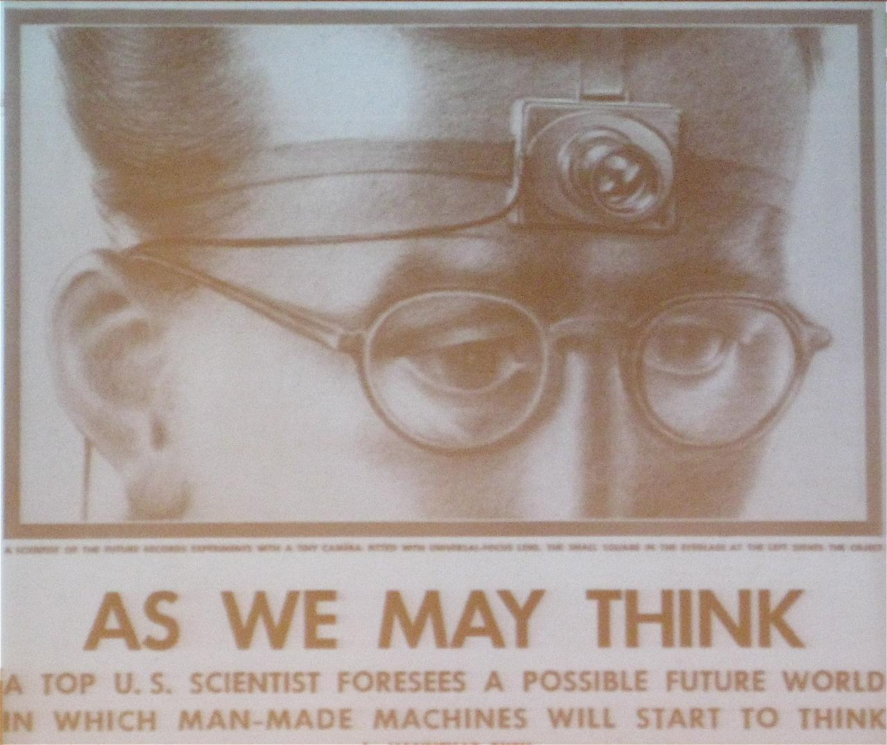
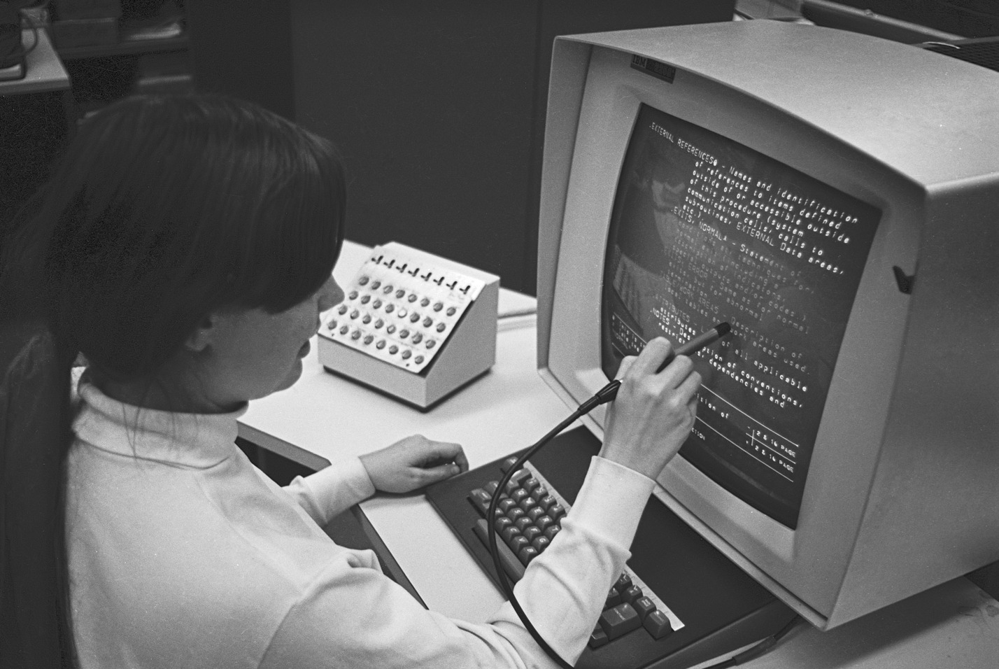
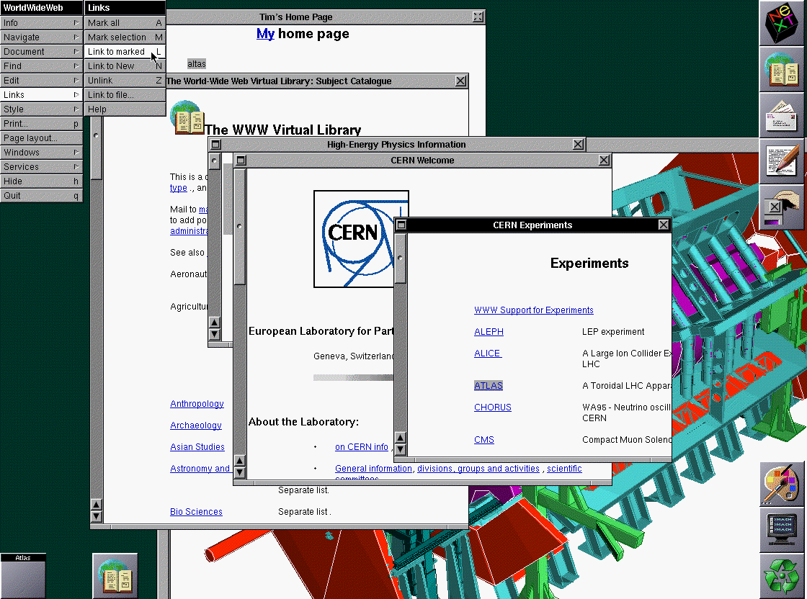
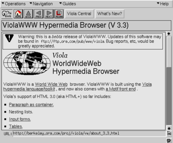
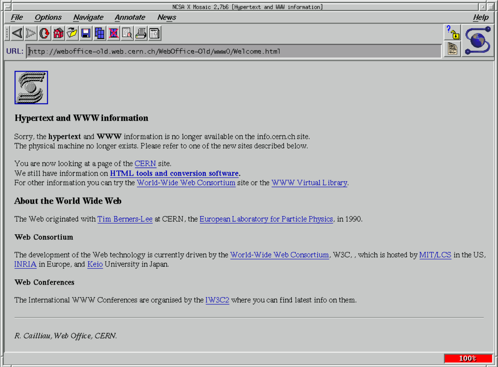
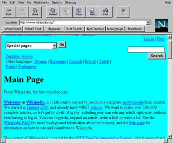
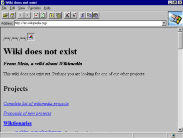

# Webの歴史（History of the Web）

> 出典: https://browser.engineering/history.html
> 取得日: 2026-11-14
> 原文: *Web Browser Engineering*（Pavel Panchekha、Chris Harrelson 著）「History of the Web」の日本語訳（学習用）

この章では、Web自体の歴史を掘り下げます。Webがどこから来たのか、そしてWebとブラウザが今日までどのように進化してきたのかです。この歴史は網羅的ではありません。[^1]焦点を当てるのは、Webにつながった主要な出来事とアイデア、そしてその発明者たちの目標と動機です。

## メメックスの構想（The Memex Concept）

*図1: 「As We May Think」の初出時の掲載。（[Dunkoman](https://www.flickr.com/people/79255326@N00)、[Wikipedia](https://commons.wikimedia.org/wiki/File:The_Memex_(3002477109).jpg)より、[CC BY 2.0](https://creativecommons.org/licenses/by/2.0/legalcode)）*

コンピューターが情報にどのような革命をもたらしうるかを探った、影響力のある初期の論考が、1945年のヴァネヴァー・ブッシュ（Vannevar Bush）によるエッセイ「[As We May Think](https://en.wikipedia.org/wiki/As_We_May_Think)」です。このエッセイは、個人が世界中のあらゆる情報を見て探索できるようにする、[メメックス](https://en.wikipedia.org/wiki/Memex)（memex）という機械を構想しました（図1参照）。それは当時のマイクロフィルムのスクリーン技術の言葉で説明されていましたが、ユーザーインターフェースや技術の詳細が違っていても、その目的と概念には、今日私たちが知るWebとの明らかな類似点があります。

Webは、その中核において、メメックスのような目標、つまり*情報を表現し表示すること*を軸に組織されており、人間が効果的に学び、探索する方法を提供します。人類の集合的な知識と知恵は、ずっと以前に、ひとつの精神、組織、図書館、国、文化、集団、言語の容量を超えました。しかし、私たち人間は、知りうることのほんの一部すら知りえない一方で、テクノロジーを使えば、以前より効率的に学べますし、*とりわけ*、学ぶ、覚える、思い出すために必要な情報にすばやくアクセスできます。ヴァネヴァー・ブッシュが描いた、次のような想像上の調査の場面を考えてみましょう。これは、私たちがときどきWebを使うやり方と驚くほどよく似ています。

> メメックスの持ち主は、たとえば、弓矢の起源と性質に関心があるとしよう。[…] 彼のメメックスには、関連しそうな本や記事が何十と入っている。まず百科事典に目を通し、興味深いがあらましだけの記事を見つけて、それを映し出したままにしておく。次に、ある歴史書で別の関連する項目を見つけ、2つを結びつける。こうして彼は、たくさんの項目からなる道筋を築いていく。

コンピューターとインターネットによって、欲しい情報を*処理して保存*できるようになります。しかし、その情報、その知識を*整理して見つけ*、役に立つものにするのは*Web*なのです。[^2]

「As We May Think」は、メメックスの2つの特徴を強調しました。情報の記録の検索と、関連する記録同士の関連付けです。実際このエッセイは後者の重要性を強調しています。私たちは、それまで知られていなかった*既知のもの同士のつながり*を作ることで学ぶのです。

> どんな種類のデータも、保管されるときには、アルファベット順か数字順に整理される。[…] 人間の心は、そのようには働かない。連想によって動くのである。

ブッシュの言う「連想」（association）とは、人間が作ったリンクを介して、ある記録から次の記録へと続く思考の道筋のことでした。彼が思い描いたのは、万能の図書館だけでなく、学んだことの成果を記録する万能の方法でもありました。

## Webの登場（The Web Emerges）

[ハイパーリンク](https://en.wikipedia.org/wiki/Hyperlink#History)で結ばれた[ハイパーテキスト](https://en.wikipedia.org/wiki/Hypertext)（hypertext）文書という概念は、1964〜65年に、テッド・ネルソン（Ted Nelson）が率いる[Project Xanadu](https://en.wikipedia.org/wiki/Project_Xanadu)によって発明されました。[^3]ハイパーテキストとは、他のテキストへのハイパーリンクでマークアップされたテキストです。[^4]聞き覚えがありませんか。Webページはハイパーテキストであり、Webページ間のリンクはハイパーリンクです。Webページを書くための形式はHTML、Webページを読み込むためのプロトコルはHTTPで、どちらの略語にも「HyperText」が含まれています。初期のHypertext Editing Systemの例は図2を参照してください。

*図2: 1969年にHypertext Editing Systemを操作するコンピューターオペレーター。（Gregory Lloyd、[Wikipedia](https://commons.wikimedia.org/wiki/File:HES_IBM_2250_Console_grlloyd_Oct1969.png)より、[CC BY-SA 4.0 International](https://creativecommons.org/licenses/by-sa/4.0/deed.en)）*

Project Xanaduとは独立に、最初のハイパーリンクシステムは、ひとつの文書の中でスクロールするためのものとして登場し、のちに複数の文書間のリンクへと一般化されました。そして、そうした最初期のシステムと同じように、Webにも文書内のリンクと文書間のリンクがあります。たとえばURL `http://browser.engineering/history.html#the-web-emerges` は、「`history.html`」という文書、なかでもその中の「`the-web-emerges`」という名前の要素、つまりこの節を指しています。そのURLにアクセスすると、この章が読み込まれ、この節までスクロールされます。

この研究は、ダグラス・エンゲルバート（Douglas Engelbart）の[すべてのデモの母](https://en.wikipedia.org/wiki/The_Mother_of_All_Demos)（mother of all demos）の重要な部分も形作り、触発しました。これはおそらく、コンピューティングの歴史で最も影響力のある技術デモンストレーションです（図3参照）。このデモは、Webの重要な概念を披露しただけでなく、コンピューターのマウスとグラフィカルユーザーインターフェースも紹介しました。どちらもブラウザUIの中心的な構成要素です。[^5]

*図3: すべてのデモの母を発表するダグ・エンゲルバート。（SRI International、[Doug Engelbart Institute](https://www.dougengelbart.org/content/view/374/464/)経由）*

こうした研究と、Webの文書・URL・ハイパーリンクという仕組みの間には、もちろんごく直接的なつながりがあります。Webはハイパーテキストのアイデアを土台とし、それを実際に応用したものです。たとえば[HyperTIES](http://www.cs.umd.edu/hcil/hyperties/)システムは、強調表示されたハイパーリンクを備え、世界初の電子出版の学術誌、すなわち1988年の[*Communications of the ACM*](https://cacm.acm.org/)の号を制作するのに使われました。ティム・バーナーズ＝リー（Tim Berners-Lee）は、この1988年の号をWorld Wide Webのインスピレーションとして挙げています。[^6]彼はそこで、リンクの概念とインターネットの普及を結びつけ、それまで数十年にわたるこれらすべての取り組みの当初の目標の多くを実現しました。[^7]

「ハイパーリンク」という言葉は、1987年にAppleコンピューター上の[HyperCard](https://en.wikipedia.org/wiki/HyperCard)システムに関連して作られたと考えられています。このシステムは、クリックなどのユーザーイベントを処理してUIを強化する動作を行うスクリプトでハイパーテキストを拡張するという概念を、最初に、あるいはおそらく史上初めて導入したシステムのひとつでもありました。Webページ上のJavaScriptとまったく同じです。また、前身のほとんどとは違って、テキストだけでなくグラフィカルなUI要素も備えていました。

1989〜1990年に、最初のWebブラウザ（WorldWideWebという名前、図4参照）とWebサーバー（UNIXの命名規則に従い、HTTP Daemonの意味で `httpd` という名前）が、ティム・バーナーズ＝リーによって書かれ、誕生しました。興味深いことに、そのブラウザの能力は、この本で実装するブラウザより劣っている面がある[^8]一方で、現代のブラウザでも利用できない能力を超えている面もあります。[^9]1990年12月20日には、[最初のWebページ](http://info.cern.ch/hypertext/WWW/TheProject.html)が作られました。この本で実装するブラウザは、今日でもこのWebページを難なく表示できます。[^10]1991年に、バーナーズ＝リーは、自分のブラウザとその概念を[`alt.hypertext` Usenetグループ](https://www.w3.org/People/Berners-Lee/1991/08/art-6484.txt)で宣伝しました。

*図4: WorldWideWebブラウザのスクリーンショット。（[*Communications of the ACM*](https://dl.acm.org/doi/10.1145/179606.179671)、1994年8月）*

バーナーズ＝リーの[Brief History of the Web](https://www.w3.org/DesignIssues/TimBook-old/History.html)は、World Wide Webが今日私たちの知るWebになった、ほかの多くの重要な要因を挙げています。重要な要因のひとつは、その分散的な性質でした。彼はそれを、自分が働いていた[CERN](https://home.cern/)の学術的な文化から生まれたものだと述べています。Webの分散的な性質は、それ以前や以後の多くのシステムとWebを区別する重要な特徴で、彼の説明はここに引用する価値があります（強調は私によるものです）。

> Enquire[^11]のようなものが必要なのは明らかだったが、それは誰にでも使えるものでなければならなかった。私は、2人が独立にそれを使い始め、のちに協力して作業を始めたときにも、拡張できるようにしたかった。そうすれば、*ほかに何の変更もせずに、互いの情報をリンクし始められる*。これがWebの概念だった。

この引用は、Webの重要な価値提案のひとつ、その分散的な性質を捉えています。Webが成功した理由はいくつかありますが、そのすべてが分散性に関係していました。

- 何をするにも門番がいなかったので、初心者でも、誰でも簡単に、単純なWebページを作って公開できた。

- ページが単純にURLで識別されたので、メール、ソーシャルネットワーキング、検索エンジンなど、外部の経路からWebにトラフィックが流れ込めた。さらに、サイト間の互換性とハイパーリンクの力が[ネットワーク効果](https://en.wikipedia.org/wiki/Network_effect)を生み、Webの*内部*からのハイパーリンクの効果をいっそう強めた。

- Webは、どれかひとつの主体の支配の外にあり、標準化団体を通じてその状態が保たれたので、独占による支配や操作という問題を避けられた。

## ブラウザ（Browsers）

最初に*広く配布された*ブラウザは、おそらく[ViolaWWW](https://en.wikipedia.org/wiki/ViolaWWW)でした（図5参照）。このブラウザは、アプレットや画像など、興味深い複数の機能の先駆けでもありました。これが、1993年に公開された[NCSA Mosaic](https://en.wikipedia.org/wiki/Mosaic_(web_browser))（図6参照）のインスピレーションになりました。Mosaicの当初の2人の作者のうちの1人は、のちにNetscapeを共同設立し、最初の*商用ブラウザ*[^12]である[Netscape Navigator](https://en.wikipedia.org/wiki/Netscape_Navigator)（図7参照）を作りました。これは1994年に公開されました。[脅威を感じた](https://lettersofnote.com/2011/07/22/the-internet-tidal-wave/)Microsoftは、1995年にInternet Explorer（図8参照）を公開し、まもなくWindows 95にバンドルしました。

*図5: ViolaWWW。（[*Viola in a Nutshell*](https://web.archive.org/web/20200706084621/http://viola.org/viola/book/preface.html)）*

*図6: Mosaic。（[Wikipedia](https://commons.wikimedia.org/wiki/File:NCSA_Mosaic_Browser_Screenshot.png)、[CC0 1.0](https://creativecommons.org/publicdomain/zero/1.0/legalcode)）*

*図7: Netscape Navigator 1.22。（[Wikipedia](https://en.wikipedia.org/wiki/File:Navigator_1-22.png#filehistory)）*

*図8: Internet Explorer 1.0。（[Wikipedia](https://en.wikipedia.org/wiki/File:Internet_Explorer_1.0.png)、[Microsoftの許可](https://www.microsoft.com/en-us/legal/copyright/permissions)を得て使用）*

[「第一次ブラウザ戦争」](https://en.wikipedia.org/wiki/Browser_wars#First_Browser_War_(1995%E2%80%932001))（first browser war）の時代が続きました。Netscape Navigatorと[Internet Explorer](https://en.wikipedia.org/wiki/Internet_Explorer)の競争です。ほかにも、市場シェアの小さいブラウザがありました。注目すべき例のひとつが[Opera](https://en.wikipedia.org/wiki/Opera_(web_browser))です。[KHTML](https://en.wikipedia.org/wiki/KHTML)プロジェクトは1999年に始まりました。[Safari](https://en.wikipedia.org/wiki/Safari_(web_browser))と、Chromeや新しいバージョンの[Edge](https://en.wikipedia.org/wiki/Microsoft_Edge)など、[Chromium](https://www.chromium.org/)ベースのブラウザは、このコードベースの子孫です。同様に、[Gecko](https://en.wikipedia.org/wiki/Gecko_(software))レンダリングエンジンは、1997年からNetscapeによって当初開発されました。[Firefox](https://en.wikipedia.org/wiki/Firefox)ブラウザは、そのコードベースの子孫です。第一次ブラウザ戦争の間に、CSS、DOM、JavaScriptなど、この本の単純なブラウザの中核的な機能のほぼすべてが追加されました。

「第二次ブラウザ戦争」は、Wikipediaによれば[2004〜2017年](https://en.wikipedia.org/wiki/Browser_wars#Second_Browser_War_(2004%E2%80%932017))で、さまざまなブラウザ、特にInternet Explorer、Firefox、Safari、Chromeの間で戦われました。当初、SafariとChromeは同じレンダリングエンジンを使っていましたが、Chromeは2013年に[Blink](https://en.wikipedia.org/wiki/Blink_(browser_engine))へフォークし、Microsoft Edgeは2020年までにそれを採用しました。第二次ブラウザ戦争では、AJAX[^13]の広範な利用、`<canvas>` などのHTML5の機能、サードパーティのJavaScriptライブラリやフレームワークの爆発的な増加など、現代のWebの多くの機能が発展しました。

## Web標準（Web Standards）

これらの動きと並行して、もうひとつ、同じくらい重要な動きがありました。WebのAPIの標準化です。1994年10月に、Web機能の監督と標準を提供するために、[World Wide Web Consortium](https://www.w3.org/Consortium/facts)（W3C）が設立されました。それ以前は、ブラウザが新しいHTML要素やAPIを導入し、競合するブラウザがそれを真似しなければならないことがよくありました。標準化団体ができたことで、それらの要素とAPIは、あとから合意され、仕様書に文書化できるようになりました。（最近では、新しい機能にはまず議論、設計、仕様策定が先行します。）のちに、HTML仕様は[WHATWG](https://whatwg.org/)という別の標準化団体に移りましたが、[CSS](https://drafts.csswg.org/)やその他の機能は今もW3Cで標準化されています。JavaScriptは、さらに別の標準化団体であるTC39（[Technical Committee 39](https://tc39.es/)、[ECMA](https://www.ecma-international.org/about-ecma/history/)内）で標準化されています。[HTTP](https://tools.ietf.org/html/rfc2616)は[IETF](https://www.ietf.org/about/)によって標準化されています。重要なのは、1990年代半ばに確立された標準化プロセスが、今も続いていることです。

Webの最初の数年には、ブラウザが標準的であり続けるのか、ひとつのブラウザが「勝って」、またひとつの独自のソフトウェアプラットフォームになってしまわないのかは、それほど明らかではありませんでした。そうならなかった理由は複数あり、コンピューティングコミュニティの平等主義的な気風や、W3Cの存在と力もそのひとつです。もうひとつの重要な理由は、Webがネットワーク的な性質を持ち、したがってWeb開発者が、ページがほとんどまたはすべてのブラウザで正しく動くことを確かめる必要があったこと（さもなければ顧客を失います）です。そのため開発者は独自拡張を避けました。逆にブラウザは、Web全体のサポートを維持するために、互いの文書化されていない挙動、バグさえも、慎重に再現するよう努めました。

そうなるのではという懸念があったにもかかわらず、どれかのブラウザが標準から公然と離脱しようとした時点は、実際にはありませんでした。[^14]その代わり、市場シェアをめぐる激しい競争は、非常に速いイノベーションと、Webの絶えず拡大するAPIと機能の集合に向けられました。それを現在では、単なる「World Wide Web」ではなく*Webプラットフォーム*（the web platform）と呼びます。これは、Webがもはや文書を閲覧する仕組みではなく、完全に実現されたコンピューティングプラットフォームとエコシステムへと進化したという事実を認めるものです。[^15]

結果、つまり複数の競合するブラウザと十分に整備された標準を踏まえると、振り返ってみれば、どのブラウザが各ブラウザ「戦争」で「勝った」か「負けた」かは、それほど重要ではありません。いずれの場合も、*Web*が勝ったのです。ユーザーを獲得し、能力を高めたからです。

## オープンソース（Open Source）

*第二次*ブラウザ戦争のもうひとつの重要で興味深い結果は、今日の主要なブラウザがすべて[^16]、*3つのオープンソースのWebレンダリング／JavaScriptエンジン*、すなわちChromium、Gecko、WebKitを基盤としていることです。[^17]ChromiumとWebKitは共通の祖先コードベースを持ち、Geckoはオープンソースとなったネットスケープの子孫なので、3つとも1990年代、つまりWebのほぼ始まりにさかのぼります。

これは偶然ではなく、実は、共通のプラットフォームAPI群に基づくレンダリングエンジンを実装する最も費用対効果の高い方法について、かなり興味深いことを教えてくれます。たとえば、名目上そのブラウザを管理している企業から報酬を受けていない独立した開発者が、コードや機能を貢献することはよくあります。ブラウザの機能の実装を専門にする企業や個人さえいます。あるブラウザの機能が別のブラウザのコードを真似ることもよくあります。そして、主要なブラウザがすべてオープンソースであることは、標準化プロセスにフィードバックされ、Webの分散的な性質を強めます。

## まとめ（Summary）

要約すると、歴史は次のように進みました。

1. 情報を表現し探索する方法について、基礎研究が行われた。

2. 必要な技術が十分に成熟すると、Web本体が提案され、実装された。

3. Webはかなり急速に普及し、Webの好機に乗じようと多くのブラウザが登場した。

4. ブラウザ間の調整を行い、独自の支配を避けるために、標準化団体が導入された。

5. ブラウザ間の競争が、その力と複雑さを急速に高めた。

6. ブラウザは、デスクトップからモバイル、組み込みまで、あらゆるデバイスとオペレーティングシステムに登場した。

7. やがて、すべてのWebレンダリングエンジンがオープンソースになった。それは、これが単一の主体より大きな共同の取り組みであることの認識だった。

Webは長い道のりを歩んできました。しかし、ひとつだけはっきりしているようです。Webはまだ完成していないということです。

## 演習（Exercises）

*iii*-1 *次に来るものは？* Webがどのように生まれ、現在の形になったかについて学んだことに基づいて、Webの将来の進化にどんな傾向を予想しますか。たとえば、Webはほかの非Web技術やプラットフォームと効果的に競争できると思いますか。

*iii*-2 *元のアイデアはどうなったか？* 実際のWebの動き方は、メメックスとはかなり違います。大きな違いのひとつは、Webの*ユーザー*がページ間にリンクを追加したり、注釈を付けたりするための組み込みの方法がないことです。なぜそうなっているのだと思いますか。元の研究の目標のうち、ほかにまだ実現していないものを思いつきますか。

[^1]: たとえば、Standard Generalized Markup Language（[SGML](https://en.wikipedia.org/wiki/Standard_Generalized_Markup_Language)）やHTMLのほかの前身については、ほとんど触れていません。（この脚注を除いて！）
[^2]: Googleのよく知られた[ミッション](https://about.google/)ステートメント「世界中の情報を整理し、世界中の人がアクセスできて使えるようにする」は、ほぼ同じです。これは偶然ではありません。検索エンジンという概念はWebと本質的に結びついており、Webとその先行物の設計に触発されたものです。
[^3]: 彼は、学術界や文学界における引用と批評の長い伝統に触発されました。Project Xanaduの研究論文は、このユースケースに強く動機づけられていました。
[^4]: その後継である[Hypertext Editing System](https://en.wikipedia.org/wiki/Hypertext_Editing_System)は、今ではすべてのブラウザが備えている「戻る」ボタンを最初に導入しました。このシステムにはテキストしかなかったので、「ボタン」自体がテキストでした。
[^5]: そのデモは、これさえも超えていました。そのうちのいくつかの部分は、まだどのコンピューターシステムでも実現されていません。ぜひ見てください！
[^6]: 現在では、World Wide Webは単に「Web」や「Webエコシステム」と呼ばれます。エコシステムは、「World Wide」と同じ概念を表すもうひとつの言い方です。元の言い回しは、多くのWebサイトのドメイン名にある「www」に生き残っています。
[^7]: Web自体が以前の野心と夢の実現であるのと同じように、今日、私たちはWebが示したビジョンの実現を目指しています。（そう、まだ完成していません！）
[^8]: CSSなし！JSなし！画像さえなし！
[^9]: たとえば、最初のブラウザには、サイト内を検索するためのインデックスページという概念があり（その名残は、URLのパスが「/」で終わるときの「index.html」という慣習として今日も残っています）、WYSIWYGのWebページエディタも備えていました（DOM要素の「contenteditable」HTML属性（[第16章](https://browser.engineering/invalidation.html)参照）は同様の意味的な挙動を持ちますが、組み込みのファイル保存はなくなっています）。今日では、インデックスは検索エンジンに置き換えられ、Webページエディタという概念は、今日のWebページレンダリングが高度に動的なため、やや時代遅れになっています。
[^10]: また、はっきりわかるように、そのWebページはその後更新されておらず、当初の美的感覚を保っています！
[^11]: Enquireは、同じくバーナーズ＝リーが書いた、Webに似たデータベースシステムの前身です。
[^12]: ここで商用とは、営利団体によって作られたという意味です。Netscapeの初期バージョンもフリーソフトウェアではなく、店で購入する必要がありました。価格は約50ドルでした。
[^13]: Asynchronous JavaScript and XML（非同期JavaScriptとXML）の略で、XMLはeXtensible Markup Languageの略です。
[^14]: Webが分断に最も近づいたのは、おそらく1990年代後半の[DHTML](https://en.wikipedia.org/wiki/Dynamic_HTML)の機能の導入のときでしょう。DHTMLは、この本で学ぶDocument Object Modelの初期バージョンです。NetscapeとInternet Explorerは、当初これらの機能について互換性のない実装を持っており、標準化が達成されるまでには、何年もの時間、共通仕様の策定、そしてブラウザへの大きな圧力キャンペーンが必要でした。この話は[Jay Hoffman](https://css-tricks.com/chapter-7-standards/)によって、さらに詳しく読めます。
[^15]: Webを中心に作られたオペレーティングシステムさえありました。たとえば、一部のPalmスマートフォンを動かした[webOS](https://en.wikipedia.org/wiki/WebOS)、（今日は[KaiOS](https://en.wikipedia.org/wiki/KaiOS)ベースの携帯電話に生き残っている）[Firefox OS](https://en.wikipedia.org/wiki/Firefox_OS)、そしてデスクトップ向けオペレーティングシステムである[ChromeOS](https://en.wikipedia.org/wiki/Chrome_OS)があります。これらのオペレーティングシステムはすべて、Webをあらゆるアプリケーションの共通のUI層として使い、その上にシステム統合のためにJavaScriptから公開されたAPIをいくつか載せる、という考え方に基づいています。
[^16]: Chromiumベースのブラウザの例には、Chrome、Edge、Opera（2013年に[Presto](https://en.wikipedia.org/wiki/Presto_(browser_engine))エンジンからChromiumに切り替えました）、Samsung Internet、Yandex Browser、UC Browser、Braveがあります。さらに、3つのエンジンのいずれかに基づく「組み込み」ブラウザが、さまざまな自動車、携帯電話、テレビ、その他の電子機器向けに数多くあります。
[^17]: JavaScriptエンジンは、実際には別々のリポジトリにあり（ほかのさまざまなサブコンポーネントも同様）、ブラウザの外でJavaScript仮想マシンとして使われることもあります。重要な応用のひとつは、[V8](https://en.wikipedia.org/wiki/V8_(JavaScript_engine))を使って[node.js](https://en.wikipedia.org/wiki/Node.js)を動かすことです。ただし、3つのレンダリングエンジンにはそれぞれ対応するJavaScript実装があるので、両者を混同しても無理はありません。
