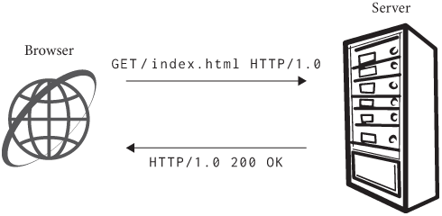
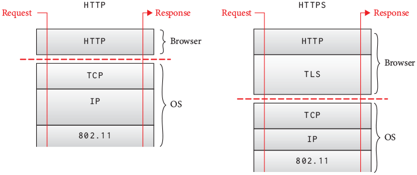

# Webページのダウンロード（Downloading Web Pages）

> 出典: https://browser.engineering/http.html
> 取得日: 2026-11-14
> 原文: *Web Browser Engineering*（Pavel Panchekha、Chris Harrelson 著）第1章の日本語訳（学習用）

Webブラウザ（web browser）は、URLで識別される情報を表示します。その最初のステップは、そのURLを使ってインターネット上のどこかにあるサーバー（server）に接続し、情報をダウンロードすることです。

## サーバーへの接続（Connecting to a Server）

インターネットの閲覧はURLから始まります。[^1]URLとは、ブラウザが訪れるべき特定のWebページを識別する短い文字列です。

```
http://example.org/index.html
```

> 図の注釈: スキーム（Scheme）、ホスト名（Hostname）、パス（Path）

図1: URLの構文。

URLは3つの部分からなります（図1参照）。スキーム（scheme）は情報を*どのように*取得するかを、ホスト名（host name）は*どこから*取得するかを、パス（path）は*どの*情報を取得するかを表します。URLにはほかにも、ポート、クエリ、フラグメントといった省略可能な部分がありますが、それらは後で見ていきます。

URLからWebページのダウンロード処理を始められます。ブラウザはまず、ローカルのオペレーティングシステム（OS）に、*ホスト名*で示された*サーバー*と接続してもらうよう頼みます。するとOSは、ドメインネームシステム（Domain Name System、DNS）サーバーに問い合わせ、`example.org` のようなホスト名を `93.184.216.34` のような*宛先IPアドレス*に変換します。[^2][^3]次にOSは、*ルーティングテーブル*（routing table）と呼ばれるものを使って、その宛先IPアドレスとの通信にどのハードウェア（たとえば無線か有線か）が最適かを決め、デバイスドライバを使って有線または無線で信号を送り出します。[^4]それらの信号は一連の*ルーター*（router）[^5]に拾われて中継され、ルーターはそれぞれメッセージを送るのに最適な方向を選び、最終的に宛先へ届きます。[^6]メッセージがサーバーに届くと、接続が確立されます。要するに、ブラウザがOSに「`example.org` と接続してほしい」と頼めば、そのとおりにしてくれる、ということです。

多くのシステムでは、`telnet` プログラムを使って次のようにこの種の接続を張れます。[^7]

```
telnet example.org 80
```

（注: 灰色の枠が付いているコードは例示にすぎず、私たちのブラウザのコードの一部では*ありません*。）

> `telnet` のインストールが必要な場合があります。デフォルトでは無効になっていることが多いためです。Windowsでは、コントロールパネルの[「プログラムと機能」→「Windowsの機能の有効化または無効化」](https://www.lifewire.com/what-is-telnet-2626026)に進みます。再起動が必要です。実行すると、何かを表示する代わりに画面がクリアされますが、それ以外は通常どおり動作します。macOSでは、`telnet` の代わりに `nc -v` コマンドが使えます。
>
> ```
> nc -v example.org 80
> ```
>
> 出力は少し違いますが、同じように動作します。ほとんどのLinuxシステムでは、パッケージマネージャーから `telnet` または `nc` をインストールできます。通常は `telnet` と `netcat` というパッケージです。

次のような出力が得られます。

```
Trying 93.184.216.34...
Connected to example.org.
Escape character is '^]'.
```

これは、OSがホスト名 `example.org` をIPアドレス `93.184.216.34` に変換し、接続に成功したことを意味します。[^8]これで `example.org` と会話できます。

> **さらに詳しく（Going Further）**
>
> URLの構文は [RFC 3986](https://tools.ietf.org/html/rfc3986) で定義されています。第一著者はティム・バーナーズ＝リー（Tim Berners-Lee）で、驚きはありません。第二著者のロイ・フィールディング（Roy Fielding）はHTTPの設計に大きく貢献した人物で、[博士論文](https://ics.uci.edu/~fielding/pubs/dissertation/fielding_dissertation_2up.pdf)でWebのREST（Representational State Transfer）アーキテクチャを説明したことでも知られています。この論文は、RESTによってWebが分散的に成長できた理由を説明しています。今日では多くのサービスがこれらの原則に従った「RESTful API」を提供していますが、それについては[いくつかの混乱](https://twobithistory.org/2020/06/28/rest.html)もあるようです。

## 情報のリクエスト（Requesting Information）

接続が確立すると、ブラウザはサーバーに*パス*を伝えて情報を要求します。パスとは、`/index.html` のようにURLのホスト名より後ろの部分です。リクエストの構造は図2に示します。試すには、これを `telnet` に入力してください。

```
GET /index.html HTTP/1.0
Host: example.org

```

> 図の注釈: メソッド（Method）、パス（Path）、HTTPバージョン（HTTP Version）、ヘッダ（Header）、値（Value）

図2: 注釈付きのHTTP GETリクエスト。

ここで `GET` という単語は、ブラウザが情報を受け取りたいことを意味します。[^9]続いてパスが来て、最後に `HTTP/1.0` という単語があります。これは、ブラウザが [HTTP](https://developer.mozilla.org/en-US/docs/Web/HTTP) のバージョン1.0を話すことをホストに伝えるものです。HTTPにはいくつかのバージョンがあります（[0.9、1.0、1.1、2.0、3.0](https://medium.com/platform-engineer/evolution-of-http-69cfe6531ba0)）。HTTP 1.1 標準にはkeep-aliveなど便利な機能が数多く追加されていますが、簡単さを優先して、私たちのブラウザはそれらを使いません。HTTP 2.0 も実装しません。1.*x* 系列よりはるかに複雑で、大規模で複雑なWebアプリケーション向けのものですが、私たちのブラウザはどのみちそれらを実行できないからです。

最初の行の後ろの各行には*ヘッダ*（header）が入ります。ヘッダは名前（`Host` など）と値（`example.org` など）を持ちます。ヘッダが違えば意味も違います。たとえば `Host` ヘッダは、あなたが相手をどのホストだと考えているかをサーバーに伝えます。[^10]送れるヘッダはほかにもたくさんありますが、今のところは `Host` だけにしておきましょう。

最後に、ヘッダの後ろに空行が1行入ります。これは、ヘッダが終わったことをホストに伝えます。では `telnet` に空行を入力してください（2行のリクエストを入力した後、Enterを2回押します）。すると `example.org` から応答が返ってくるはずです。

> **さらに詳しく（Going Further）**
>
> HTTP/1.0 は [RFC 1945](https://tools.ietf.org/html/rfc1945) で、HTTP/1.1 は [RFC 2616](https://tools.ietf.org/html/rfc2616) で標準化されています。HTTPは理解しやすく実装しやすいように設計されており、あらゆる種類のコンピューターが採用しやすくなっています。HTTPを `telnet` に直接入力できるのは偶然ではありません。HTTPがプレーンテキストと改行を使う「行指向プロトコル」（line-based protocol）であり、電子メール用のSimple Mail Transfer Protocol（[SMTP](https://en.wikipedia.org/wiki/Simple_Mail_Transfer_Protocol)）に似ているのも、偶然ではありません。そもそもこのパターンは、初期のコンピューターが行単位のテキスト入力しか持たなかったことに由来します。実際、最初期の2つのブラウザのうち1つには、[行モードのUI](https://en.wikipedia.org/wiki/Line_Mode_Browser)がありました。

## サーバーの応答（The Server's Response）

サーバーの応答は、図3の行から始まります。

```
HTTP/1.0 200 OK
```

> 図の注釈: HTTPバージョン（HTTP Version）、レスポンスコード（Response Code）、レスポンスの説明（Response Description）

図3: HTTPレスポンスの最初の行（注釈付き）。

これは、ホストも `HTTP/1.0` を話すこと、そしてリクエストが「OK」（数値コードは200）だったと判断したことを伝えています。`404 Not Found` はご存じかもしれません。これも数値コードと応答の組で、`403 Forbidden` や `500 Server Error` も同様です。こうしたコードはたくさんあり、かなりうまく整理されています。[^11]

- 100番台は情報を知らせるメッセージです。

- 200番台は成功を意味します。

- 300番台は追加の操作を求めるものです（たいていはリダイレクトです）。

- 400番台は、不正なリクエストを送ったことを意味します。

- 500番台は、サーバーがリクエストをうまく処理できなかったことを意味します。

エラーコードが2系統（400番台と500番台）あり、サーバーとブラウザのどちらに非があるかがわかるようになっているのは、見事な発想です。[^12]コードの全一覧は[Wikipedia](https://en.wikipedia.org/wiki/List_of_HTTP_status_codes)で見られ、新しいコードも折にふれて追加されます。

`200 OK` の行の後ろで、サーバーは自分のヘッダを送ってきます。私が試したときは、次のようなヘッダが返ってきました（皆さんの結果は異なるでしょう）。

```
Age: 545933
Cache-Control: max-age=604800
Content-Type: text/html; charset=UTF-8
Date: Mon, 25 Feb 2019 16:49:28 GMT
Etag: "1541025663+gzip+ident"
Expires: Mon, 04 Mar 2019 16:49:28 GMT
Last-Modified: Fri, 09 Aug 2013 23:54:35 GMT
Server: ECS (sec/96EC)
Vary: Accept-Encoding
X-Cache: HIT
Content-Length: 1270
Connection: close
```

ここには*たくさんの*情報があります。要求している情報についてのもの（`Content-Type`、`Content-Length`、`Last-Modified`）、サーバーについてのもの（`Server`、`X-Cache`）、ブラウザがこの情報をどれくらいの間キャッシュすべきかについてのもの（`Cache-Control`、`Expires`、`Etag`）、そのほかさまざまなものです。今のところは先へ進みましょう。

ヘッダの後ろには空行があり、続いて大量の [HTML](https://developer.mozilla.org/en-US/docs/Web/HTML) コードが来ます。これはサーバーの応答の*ボディ*（body）と呼ばれます。ブラウザがそれをHTMLだと判断できるのは、`Content-Type` ヘッダが `text/html` だと言っているからです。Webページそのものの内容を含んでいるのが、このHTMLコードです。

HTTPのリクエストとレスポンスのやり取りは、図4にまとめてあります。手作業での接続から、プログラムでの実装に話を移しましょう（原書の実装言語はPythonですが、このリポジトリではGoで実装します）。



*図4: HTTPのリクエストとレスポンスの組によって、Webブラウザはウェブサーバーからウェブページを取得する。*

> 図の補足: 画像内の英語テキストは訳していません。ブラウザがサーバーへリクエストを送り、サーバーがレスポンスを返す流れを表しています。

> **さらに詳しく（Going Further）**
>
> Wikipediaには、HTTPの[ヘッダ](https://en.wikipedia.org/wiki/List_of_HTTP_header_fields)と[レスポンスコード](https://en.wikipedia.org/wiki/List_of_HTTP_status_codes)の優れた一覧があります。レスポンスコードの中には、[402](https://developer.mozilla.org/en-US/docs/Web/HTTP/Status/402)「Payment Required」のように、ほとんど使われないものもあります。このコードは「デジタル現金や（マイクロ）決済システム」で使うことを想定していました。eコマースはレスポンスコード402がなくても盛んですが、[マイクロペイメント](https://en.wikipedia.org/wiki/Micropayment)は（まだ？）あまり普及していません。それでも、私を含む多くの人が良いアイデアだと思っています。

## GoでのTelnet（Telnet in Python）

> 訳注: 原書の見出しは「Telnet in Python」で、コードもPythonです。このリポジトリでは原書のPythonコードをGoに置き換えて読み進めます。以降のコードは [browser.go](browser.go) に対応します。

ここまでは `telnet` を使って別のコンピューターと通信してきました。しかし `telnet` はごく単純なプログラムで、同じことをプログラムから行えます。そのためには、URLからホスト名とパスを取り出し、*ソケット*（socket）を作り、リクエストを送り、レスポンスを受け取る必要があります。[^13]

まずURLの解析から始めましょう。Goにはクラスもコンストラクタもないので、`URL` という構造体（struct）を定義し、解析のコードは `ParseURL` というコンストラクタ代わりの関数に入れます。

```go
type URL struct {
	Scheme string
	Host   string
	Port   int
	Path   string
}

func ParseURL(raw string) (*URL, error) {
	// ...
}
```

`ParseURL` は、解析に失敗したときのために `error` も一緒に返します。Goには例外がなく、失敗は戻り値で伝えるのが慣習です。`Port` フィールドは後で使うので、先に用意しておきます。

まずスキームから始めましょう。スキームは、URLの残りの部分と `://` で区切られています。私たちのブラウザがサポートするのは `http` だけなので、それも確認しておきます。

```go
func ParseURL(raw string) (*URL, error) {
	scheme, rest, ok := strings.Cut(raw, "://")
	if !ok {
		return nil, fmt.Errorf("invalid URL %q: missing scheme", raw)
	}
	if scheme != "http" {
		return nil, fmt.Errorf("unsupported scheme %q", scheme)
	}
	u := &URL{Scheme: scheme}
	// ...
}
```

次に、ホストとパスを分けなければなりません。ホストは最初の `/` の前にあり、パスはそのスラッシュとそれ以降のすべてです。

```go
func ParseURL(raw string) (*URL, error) {
	// ...
	if !strings.Contains(rest, "/") {
		rest += "/"
	}
	host, path, _ := strings.Cut(rest, "/")
	u.Host = host
	u.Path = "/" + path
	return u, nil
}
```

（`// ...` を含むコードブロックは、このように既存の関数やブロックにコードを追加することを意味します。）`strings.Cut(s, sep)` は、文字列を最初の `sep` の位置で2つに分け、前半・後半・見つかったかどうかを返します。ホスト名とパスの間のスラッシュの扱いに、少し込み入ったロジックがあることに注意してください。その（省略可能な）スラッシュはパスの一部です。

これで `URL` は `Host` と `Path` のフィールドを持ったので、そのURLのWebページをダウンロードできます。新しいメソッド `Request` で行いましょう。

```go
func (u *URL) Request() (string, error) {
	// ...
}
```

Goでは、メソッドは関数名の前に*レシーバ*（receiver）`(u *URL)` を書いて定義します。レシーバは、C++やJavaの `this` にあたるものです。今後は、メソッドの定義をここまで大げさに説明することはしません。まだ存在しないメソッドや関数の中にコードがあるコードブロックを見たら、それはそのメソッドや関数を定義しているということです。

Webページをダウンロードする最初のステップは、ホストへの接続です。OSはそのために「ソケット」という機能を提供しています。ほかのコンピューターと話したいとき（何かを伝えるためでも、相手が伝えてくるのを待つためでも）、ソケットを作ると、そのソケットで情報を双方向にやり取りできます。ほかのコンピューターと話す方法は複数あるため、ソケットにはいくつかの種類があります。

- ソケットには*アドレスファミリ*（address family）があり、相手のコンピューターをどう見つけるかを示します。OSのAPIでは名前が `AF` で始まり、たとえばIPv4なら `AF_INET`、Bluetoothなら `AF_BLUETOOTH` などがあります。

- ソケットには*タイプ*（type）があり、どのような会話が行われるかを表します。名前は `SOCK` で始まります。ここで使いたいのは `SOCK_STREAM` で、これは各コンピューターが任意の量のデータを送れることを意味します。一方、`SOCK_DGRAM` というものもあり、こちらは一定サイズのパケットをやり取りします。[^14]

- ソケットには*プロトコル*（protocol）があり、2台のコンピューターが接続を確立する手順を表します。プロトコルの名前はアドレスファミリによって変わりますが、ここで使いたいのは `IPPROTO_TCP` です。[^15]

Goでは、これらのオプションを1つずつ選ぶ代わりに、`net.Dial` に `"tcp"` という文字列を渡します。`"tcp"` は「ストリーム型（`SOCK_STREAM`）のTCP接続で、アドレスファミリはIPv4でもIPv6でも、名前解決の結果に合わせる」という意味です。[^16]

ソケットの作成と、相手のコンピューターへの接続は、`net.Dial` がまとめて行います。接続にはホストと*ポート*（port）が必要です。ポートは使うプロトコルによって決まります。今のところは80にします。

```go
func (u *URL) Request() (string, error) {
	addr := net.JoinHostPort(u.Host, "80")
	conn, err := net.Dial("tcp", addr)
	if err != nil {
		return "", err
	}
	defer conn.Close()
	// ...
}
```

これで `example.org` と通信して接続を確立し、両方のコンピューターがデータをやり取りできる状態になります。接続を閉じる `conn.Close()` は、接続に成功した直後に `defer` で予約しておきます。`defer` した呼び出しは、関数がどの経路で終わるとき（途中の `return` でも）にも実行されるので、閉じ忘れを防げます。

> **注意点（Quirk）**
>
> オフラインのときは、当然これは動きません。プロキシの内側にいる場合や、もっと複雑なさまざまなネットワーク環境でも動かないことがあります。回避策は環境によって異なります。プロキシを無効にするだけで済むかもしれませんし、もっとずっと複雑かもしれません。

ホストとポートを `host + ":" + port` と文字列連結せず、`net.JoinHostPort` で組み立てている点に注意してください。IPv6アドレスは `::1` のようにコロンを含み、`[::1]:80` のように角括弧で囲む必要があります。`JoinHostPort` はその処理を代わりにやってくれます。

> **さらに詳しく（Going Further）**
>
> 「ソケット」APIは、1983年の4.2 BSD Unix向けの元祖「[バークレーソケット](https://en.wikipedia.org/wiki/Berkeley_sockets)」APIの設計に由来します。Goの `net` パッケージはこれを使いやすく包んだもので、中ではOSのソケットを呼び出しています。もちろんWindowsやLinuxはこのAPIを再実装しているだけですが、macOSやiOSは、BSD Unixの流れをくむ大量のコードを[今も使っています](https://developer.apple.com/library/archive/documentation/Darwin/Conceptual/KernelProgramming/BSD/BSD.html)。

## リクエストとレスポンス（Request and Response）

接続ができたので、相手のサーバーにリクエストを送ります。そのために、接続にデータを書き込みます。

```go
func (u *URL) Request() (string, error) {
	// ...
	request := fmt.Sprintf("GET %s HTTP/1.0\r\n", u.Path)
	request += fmt.Sprintf("Host: %s\r\n", u.Host)
	request += "\r\n"
	if _, err := io.WriteString(conn, request); err != nil {
		return "", err
	}
}
```

`io.WriteString` は、リクエストをサーバーに送るだけです。[^17]このコードには、正確でなければならない点がいくつかあります。まず、改行には `\n` ではなく `\r\n` を使うことが非常に重要です。また、リクエストの最後に `\r\n` の改行を*2つ*置いて、末尾に空行を送ることも不可欠です。これを忘れると、相手のコンピューターはあなたがその改行を送ってくるのを待ち続け、あなたは相手の応答を待ち続けることになります。[^18]

文字列とバイト列の関係にも注目してください。データを送るときは、送っているのは生のビットとバイトであり、それがテキストにも画像にも動画にもなりうることを覚えておく必要があります。Goの `string` は不変のバイト列で、ソースコード中の文字列リテラルはUTF-8です。ですから、Pythonの `encode` のような変換は要りません。可変のバイト列は `[]byte` という別の型で、両者の変換は明示的に書きます。[^19]

```go
s := "text"
b := []byte(s)
fmt.Printf("%T %T\n", s, b) // string []uint8
```

`string` と `[]byte` のどちらを渡すべきかでコンパイルエラーが出たら、どこかで `[]byte(...)` か `string(...)` の変換を忘れたということです。

サーバーの応答を読むには、接続の `Read` を使って、すでに届いている応答の断片を受け取れます。そのうえで、届いた断片を集めるループを書きます。しかしGoでは、そのループを隠してくれる `bufio.NewReader` が使えます。[^20]

```go
func (u *URL) Request() (string, error) {
	// ...
	response := bufio.NewReader(conn)
}
```

ここで `bufio.NewReader` は、サーバーから受け取ったバイトを、行単位などで読めるようにしてくれるラッパーです。Goはバイトを自動で文字列にデコードしないので、読んだ内容はそのまま `string` に入ります。ここでは、バイトがUTF-8であるとみなして扱います。[^21]HTTPの変わった改行コード `\r\n` も、自動では処理されません。行を読むと末尾の `\r\n` が残るので、必要に応じて自分で取り除きます。

では、応答をいくつかの部分に分割しましょう。最初の行はステータス行です。[^22]

```go
func (u *URL) Request() (string, error) {
	// ...
	statusline, err := response.ReadString('\n')
	if err != nil {
		return "", fmt.Errorf("reading status line: %w", err)
	}
	parts := strings.SplitN(strings.TrimRight(statusline, "\r\n"), " ", 3)
	if len(parts) < 2 {
		return "", fmt.Errorf("malformed status line %q", statusline)
	}
	// parts[0] = バージョン, parts[1] = ステータスコード, parts[2] = 説明
}
```

サーバーのHTTPバージョン（`parts[0]`）が自分のものと同じかどうかは確認*しない*ことに注意してください。確認するのは良い考えに思えるかもしれませんが、HTTP 1.0で話しかけてもHTTP 1.1で応答する設定ミスのサーバーが世の中にはたくさんあるのです。[^23]

ステータス行の後ろにはヘッダが続きます。

```go
func (u *URL) Request() (string, error) {
	// ...
	headers := map[string]string{}
	for {
		line, err := response.ReadString('\n')
		if err != nil {
			return "", fmt.Errorf("reading headers: %w", err)
		}
		if line == "\r\n" {
			break
		}
		name, value, ok := strings.Cut(line, ":")
		if !ok {
			return "", fmt.Errorf("malformed header line %q", line)
		}
		headers[strings.ToLower(name)] = strings.TrimSpace(value)
	}
}
```

ヘッダについては、各行を最初のコロンで分割して、ヘッダ名からヘッダ値へのマップ（map）を埋めていきます。ヘッダは大文字小文字を区別しないので、小文字に正規化します。[^24]また、HTTPヘッダ値の空白には意味がないので、前後の余分な空白は取り除きます。

ヘッダはあらゆる種類の情報を表せますが、そのうちのいくつかは特に重要です。私たちが取得しようとしているデータが普通ではない方法で送られていることを、教えてくれるからです。それらが存在しないことを確認しておきましょう。[^25]

```go
func (u *URL) Request() (string, error) {
	// ...
	if _, ok := headers["transfer-encoding"]; ok {
		return "", fmt.Errorf("transfer-encoding is not supported")
	}
	if _, ok := headers["content-encoding"]; ok {
		return "", fmt.Errorf("content-encoding is not supported")
	}
}
```

すると、送られてきたデータを得る通常の方法は、ヘッダの後ろにあるすべてを読むことです。

```go
func (u *URL) Request() (string, error) {
	// ...
	body, err := io.ReadAll(response)
	if err != nil {
		return "", fmt.Errorf("reading body: %w", err)
	}
}
```

表示したいのはボディなので、それを返しましょう。接続を閉じる処理は、先ほど `defer` で予約してあります。

```go
func (u *URL) Request() (string, error) {
	// ...
	return string(body), nil
}
```

では、レスポンスボディのテキストを実際に表示しましょう。

> **さらに詳しく（Going Further）**
>
> [`Content-Encoding`](https://developer.mozilla.org/en-US/docs/Web/HTTP/Headers/Content-Encoding) ヘッダを使うと、サーバーはWebページを圧縮してから送れます。テキストの多い大きなWebページはよく圧縮でき、その結果、ページの読み込みが速くなります。ブラウザは、サポートする圧縮アルゴリズムを列挙した [`Accept-Encoding` ヘッダ](https://developer.mozilla.org/en-US/docs/Web/HTTP/Headers/Accept-Encoding)をリクエストに含めて送る必要があります。[`Transfer-Encoding`](https://developer.mozilla.org/en-US/docs/Web/HTTP/Headers/Transfer-Encoding) も同様のもので、データを「チャンク化」（chunked）することもできます。多くのサーバーが、これを圧縮と併用しているようです。

## HTMLの表示（Displaying the HTML）

レスポンスボディのHTMLコードは、`http://example.org/index.html` にアクセスしたときにブラウザウィンドウで目にする内容を定義しています。HTMLについては今後の章でずっと詳しく説明しますが、今のところはごく単純にしておきます。

HTMLには*タグ*（tag）と*テキスト*（text）があります。タグはそれぞれ `<` で始まり `>` で終わります。大まかに言えば、タグはある内容がどんな種類のものかを伝え、テキストが実際の内容です。[^26]ほとんどのタグは開始タグと終了タグのペアになっています。たとえばページのタイトルは、`<title>` と `</title>` というタグのペアで囲まれます。各タグは山括弧の中にタグ名（ここでは `title`）を持ち、その後ろに必要に応じて空白と*属性*（attribute）が続きます。ペアとなる終了タグは、`/` とタグ名（属性は付きません）を持ちます。

そこで、ごく単純なWebブラウザを作るために、ページのHTMLを受け取って、その中のテキストだけを（タグは除いて）すべて表示することにしましょう。[^27]これを新しい関数 `Show` で行います。[^28]

```go
func Show(w io.Writer, body string) {
	inTag := false
	for _, c := range body {
		switch {
		case c == '<':
			inTag = true
		case c == '>':
			inTag = false
		case !inTag:
			fmt.Fprint(w, string(c))
		}
	}
}
```

このコードはかなり複雑です。リクエストボディを1文字ずつ処理し、2つの状態を持ちます。現在山括弧の間にいる `inTag` と、そうでない `!inTag` です。現在の文字が山括弧のとき、状態が切り替わります。タグの外にある通常の文字は表示されます。[^29]

これで `Request` と `Show` をつなぎ合わせるだけで、Webページを読み込めます。[^30]

```go
func Load(w io.Writer, u *URL) error {
	body, err := u.Request()
	if err != nil {
		return err
	}
	Show(w, body)
	return nil
}
```

コマンドラインから `Load` を実行するために、次のコードを追加してください。

```go
func main() {
	if len(os.Args) < 2 {
		fmt.Fprintln(os.Stderr, "usage: browser <url>")
		os.Exit(2)
	}
	u, err := ParseURL(os.Args[1])
	if err != nil {
		fmt.Fprintln(os.Stderr, "error:", err)
		os.Exit(1)
	}
	if err := Load(os.Stdout, u); err != nil {
		fmt.Fprintln(os.Stderr, "error:", err)
		os.Exit(1)
	}
}
```

`main` 関数は、Goがプログラムを実行するときに最初に呼ぶ関数です。このコードは、コマンドラインの最初の引数（`os.Args[1]`）を読み取り、それをURLとして使います。URL `http://example.org/` でこのコードを実行してみましょう。

```sh
go run ./chapters/01-http http://example.org/
```

公式のサンプルWebページへようこそ、という短いテキストが表示されるはずです。[この章](http://browser.engineering/http.html)に対して使ってみることもできます！

> **さらに詳しく（Going Further）**
>
> HTMLも、URLやHTTPと同じように、基本的なレベルでは非常に簡単に解析・表示できるよう設計されています。そして当初のHTMLには機能がほとんどなかったため、ここで見たものよりそれほど高機能でないものを作るだけで、内容を実用的に表示できました。私たちのごく単純で基本的なHTMLパーサーでも、すでに [browser.engineering](https://browser.engineering/) のWebサイトのテキストを表示できます。

## 暗号化された接続（Encrypted Connections）

ここまでで、私たちのブラウザは `http` スキームをサポートしています。これはごく一般的なスキームです。しかし、`https` スキームへ移行するWebサイトはますます増えており、それを必須とするWebサイトも多くあります。

`http` と `https` の違いは、`https` のほうが安全であることです。ただ、もう少し具体的に言いましょう。`https` スキーム、より正式にはHTTP over TLS（Transport Layer Security）は、ブラウザとホストの間のすべての通信が暗号化される点を除いて、通常の `http` スキームと同じです。この仕組みには、どの暗号化アルゴリズムを使うか、共通の暗号鍵をどう取り決めるか、そしてもちろんブラウザが正しいホストに接続していることをどう確かめるかなど、多くの詳細があります。関係するプロトコル層の違いを図5に示します。



*図5: HTTPとHTTPSの違いは、TLS層が加わることである。*

> 図の補足: 画像内の英語テキストは訳していません。HTTPSでは、HTTPとTCPの間にTLS層が加わることを表しています。

幸いGoの `crypto/tls` パッケージがこれらの詳細をすべて実装してくれているので、暗号化された接続を作るのは、通常の接続を作るのとほとんど同じくらい簡単です。この手軽さは、状況によっては不適切かもしれないデフォルト設定を受け入れることと引き換えですが、教育目的なら問題ありません。

`crypto/tls` で暗号化された接続を作るのはとても簡単です。すでに接続 `conn` を作って `example.org` に接続したとします。接続を暗号化するには、`tls.Config` で*設定*（config）`cfg` を作り、その設定で接続 `conn` を*ラップ*（wrap）します。

```go
cfg := &tls.Config{ServerName: host}
conn = tls.Client(conn, cfg)
```

`tls.Client` は新しい接続を返すので、それを変数 `conn` に保存し直していることに注意してください。元の接続でデータを送りたくないからです。暗号化されませんし、混乱のもとにもなります。`ServerName` は、正しいサーバーに接続したことを確認するために使われます。`Host` ヘッダと一致している必要があります。`tls.Config` をゼロ値のままにすると、OSの信頼済み証明書を使って検証する、安全なデフォルト設定になります。

> 訳注: 原書はmacOSでPythonの `ssl` を使う前に「Install Certificates」というプログラムを実行する必要がある、と説明しています。GoはmacOSではシステムの証明書ストアを使って検証するため、通常はこの手順は要りません。

このコードを `Request` に加えてみましょう。まず、どのスキームが使われているかを検出する必要があります。

```go
func ParseURL(raw string) (*URL, error) {
	scheme, rest, ok := strings.Cut(raw, "://")
	if !ok {
		return nil, fmt.Errorf("invalid URL %q: missing scheme", raw)
	}
	if scheme != "http" && scheme != "https" {
		return nil, fmt.Errorf("unsupported scheme %q", scheme)
	}
	u := &URL{Scheme: scheme}
	// ...
}
```

（ここでは、既存のスキーム解析のコードをこの新しいコードに置き換えることになっている点に注意してください。何を置き換えるべきかは、たいてい文脈とコード自体から明らかです。）

暗号化されたHTTP接続は、通常80番ではなく443番ポートを使います。

```go
func ParseURL(raw string) (*URL, error) {
	// ...
	if scheme == "http" {
		u.Port = 80
	} else {
		u.Port = 443
	}
	// ...
}
```

接続するときに、このポートを使えます。

```go
func (u *URL) Request() (string, error) {
	addr := net.JoinHostPort(u.Host, strconv.Itoa(u.Port))
	conn, err := net.Dial("tcp", addr)
	if err != nil {
		return "", err
	}
	// ...
}
```

次に、`crypto/tls` で接続をラップします。

```go
func (u *URL) Request() (string, error) {
	// ...
	if u.Scheme == "https" {
		cfg := &tls.Config{ServerName: u.Host}
		conn = tls.Client(conn, cfg)
	}
	defer conn.Close()
	// ...
}
```

`defer conn.Close()` は、ラップし終わった後の `conn` に対して予約する必要があります。先ほどの「GoでのTelnet」の節で `defer` を書いた位置は、ここに移すことになります。

これで、ブラウザはHTTPSのサイトに接続できるはずです。

ついでに、カスタムポートのサポートも追加しましょう。カスタムポートは、図6のように、URLでホスト名の後ろにコロンを置いて指定します。

```
http://example.org:8080/index.html
```

> 図の注釈: ポート（Port）

図6: URLにおけるポートの位置。

URLにポートがあれば、それを解析して使えます。

```go
func ParseURL(raw string) (*URL, error) {
	// ...
	if h, p, ok := strings.Cut(u.Host, ":"); ok {
		port, err := strconv.Atoi(p)
		if err != nil {
			return nil, fmt.Errorf("invalid port %q: %w", p, err)
		}
		u.Host, u.Port = h, port
	}
	return u, nil
}
```

カスタムポートはデバッグに便利です。Pythonには、自分のコンピューター上のファイルを配信できる組み込みのWebサーバーがあります。たとえば次のように実行すると、

```sh
python3 -m http.server 8000 -d /some/directory
```

`http://localhost:8000/` にアクセスすると、そのディレクトリ内のすべてのファイルが表示されるはずです。これはブラウザをテストするのに良い方法です。

> 訳注: このサーバーはブラウザの実装言語とは関係なく使えるツールなので、原文のままにしています。このリポジトリの自動テストは、Goの `net/http/httptest` で用意したテスト用サーバーに接続します。

> **さらに詳しく（Going Further）**
>
> TLSはかなり複雑です。詳細は [RFC 8446](https://tools.ietf.org/html/rfc8446) で読めますが、自前で実装することはお勧めしません。正しいだけでなく安全でもあるカスタムTLS実装を書くのは、非常に難しいのです。

ここまでで、プログラムを任意のWebページに対して実行できるはずです。[簡単な例](https://browser.engineering/examples/example1-simple.html)に対する出力は次のようになります。

```

    This is a simple
    web page with some
    text in it.

```

## まとめ（Summary）

この章では、空のファイルから出発して、次のことができる初歩的なWebブラウザを作りました。

- URLをスキーム、ホスト、ポート、パスに解析する。

- `net` と `crypto/tls` パッケージを使ってそのホストに接続する。

- `Host` ヘッダを含むHTTPリクエストをそのホストに送る。

- HTTPレスポンスをステータス行、ヘッダ、ボディに分割する。

- ボディ内のテキストを（タグは除いて）表示する。

確かに、これはまだWebブラウザというよりコマンドラインツールですが、すでにブラウザの中核的な機能のいくつかを備えています。

## アウトライン（Outline）

私たちのブラウザの関数、型、メソッドの全体は、次のようになっているはずです。

```go
type URL struct { ... }

func ParseURL(raw string) (*URL, error)

func (u *URL) Request() (string, error)

func Show(w io.Writer, body string)

func Load(w io.Writer, u *URL) error
```

## 演習（Exercises）

1-1 *HTTP/1.1*。`request` 関数で、`Host` に加えて、値を `close` にした `Connection` ヘッダを送ってください。これでブラウザは `HTTP/1.1` を使っていると宣言できます。あわせて `User-Agent` ヘッダも追加してください。値は何でもかまいません。ホストに対してあなたのブラウザを識別するものです。今後ヘッダを追加しやすいようにしてください。

1-2 *ファイルURL*。ローカルファイルを開けるようにする `file` スキームのサポートを追加してください。たとえば `file:///path/goes/here` は、あなたのコンピューター上の `/path/goes/here` にあるファイルを指すようにします。また、URLを指定せずにブラウザを起動した場合は、コンピューター上の特定のファイルを開くようにしてください。そのファイルを手早いテストに使えます。

1-3 *`data`*。もう1つのスキームが `data` で、HTMLの内容をURL自体にインライン化できます。実際のブラウザで `data:text/html,Hello world!` に移動して、何が起こるか試してみてください。このスキームのサポートをブラウザに追加してください。`data` スキームは、別ファイルにしなくてもテストが作れるので、特に便利です。

1-4 *エンティティ*。小なり（`&lt;`）と大なり（`&gt;`）のエンティティ（entity）のサポートを実装してください。これらはそれぞれ `<` と `>` として表示されるべきです。たとえば、HTMLレスポンスが `&lt;div&gt;` だった場合、ブラウザの `show` メソッドは `<div>` を表示するようにします。エンティティを使うと、Webページは、ブラウザにタグとして解釈されることなく、これらの特殊文字を含められます。

1-5 *`view-source`*。`view-source` スキームのサポートを追加してください。`view-source:http://example.org/` に移動すると、レンダリングされたページの代わりにHTMLソースを表示するようにします。このスキームのサポートを追加してください。ブラウザは、HTMLファイル全体をテキストのように表示するはずです。演習1-4も実装しておくとよいでしょう。

1-6 *Keep-alive*。演習1-1を実装してください。ただし `Connection: close` ヘッダは送らず、代わりに `Connection: keep-alive` を送ります。ソケットからボディを読むときは、`Content-Length` ヘッダで示されたバイト数だけを読み、その後ソケットを閉じないでください。代わりにソケットを保存しておき、同じサーバーへ別のリクエストが行われたら、新しくソケットを作らずに同じソケットを再利用します。（Goでは `io.ReadFull` や `io.LimitReader` で、バイト数を指定して読めます。原書のPythonでは `makefile` に `"rb"` を渡して、文字ではなくバイトで読む必要があります。）これにより、同じサーバーへの繰り返しのリクエスト（よくあることです）が高速になります。

1-7 *リダイレクト*。300番台のエラーコードはリダイレクトを要求します。ブラウザがそれに遭遇したら、`Location` ヘッダで指定されたURLへ新しいリクエストを行うようにしてください。`Location` ヘッダが完全なURLのこともありますが、ホストとスキームを省略して `/` で始まるだけのこともあります（元のリクエストと同じホストとスキームを意味します）。新しいURLがさらにリダイレクトの場合もあるので、そのケースも扱ってください。ただし、リダイレクトのループにはまり込みたくないので、ブラウザが連続して従うリダイレクトの回数に上限を設けてください。この章のページにリダイレクトするURL [http://browser.engineering/redirect](http://browser.engineering/redirect) と、より複雑なリダイレクトの連鎖を行う兄弟分の [/redirect2](http://browser.engineering/redirect2)、[/redirect3](http://browser.engineering/redirect3) で試せます。

1-8 *キャッシュ*。一般に、同じ画像、スタイル、スクリプトが複数のページで使われます。それらを何度もダウンロードするのは無駄です。`GET` でリクエストし、`200` のレスポンスを受け取ったものであれば、どのHTTPレスポンスもキャッシュして一般に問題ありません。[^31]ブラウザにキャッシュを実装し、同じファイルを複数回リクエストしてテストしてください。サーバーは `Cache-Control` ヘッダでキャッシュを制御します。このヘッダ、具体的には `no-store` と `max-age` の値のサポートを追加してください。`Cache-Control` ヘッダにこの2つ以外の値が含まれている場合は、そのレスポンスをキャッシュしないのが無難です。

1-9 *圧縮*。HTTP圧縮のサポートを追加してください。これは、ブラウザが圧縮データを受け付けることを[サーバーに知らせる](https://developer.mozilla.org/en-US/docs/Web/HTTP/Content_negotiation)ものです。ブラウザは、値を `gzip` にした `Accept-Encoding` ヘッダを送らなければなりません。サーバーが圧縮をサポートしていれば、レスポンスには値が `gzip` の `Content-Encoding` ヘッダが付きます。その場合、ボディは圧縮されています。このケースのサポートを追加してください。データの展開には、`compress/gzip` パッケージの `gzip.NewReader` が使えます。GZipデータは UTF-8 のテキストではないので、展開するまでは生のバイト列のまま扱ってください（原書のPythonでは `gzip` モジュールの `decompress` と、`makefile` への `"rb"` を使います）。ほとんどのWebサーバーは、[`chunked`](https://developer.mozilla.org/en-US/docs/Web/HTTP/Headers/Transfer-Encoding) と呼ばれる `Transfer-Encoding` で圧縮データを送ります。[^32]それへの対応も追加する必要があります。

[^1]: 「URL」は「uniform resource locator」の略です。Webページ（リソース）を識別するための可搬な（uniform）方法であること、そしてそれらのファイルへのアクセス方法も記述している（locator）ことを意味します。
[^2]: `nslookup.io` のようなDNS検索ツールや `dig` コマンドを使えば、この変換を自分で行えます。（[nslookup.io](https://nslookup.io)）
[^3]: 現在、IP（Internet Protocol）にはIPv4とIPv6の2つのバージョンがあります。IPv6アドレスはずっと長く、通常は16進数で書かれますが、それ以外の違いはここでは重要ではありません。
[^4]: ここでは手順を省略しています。有線では、まず通信をイーサネットフレームで包む必要があり、無線ではさらに多くのことが必要です。簡潔にしようとしています。
[^5]: あるいはスイッチやアクセスポイントなど、さまざまな可能性がありますが、最終的にはルーターに行き着きます。
[^6]: ルーターは、返信を転送し返せるように、メッセージの送信元を記録することもあります。
[^7]: 「80」はポートで、後で説明します。
[^8]: エスケープ文字についての行は、`telnet` の難解な機能の使い方を示す案内にすぎません。
[^9]: 情報を送るつもりなら `POST` と言うこともできます。そのほかにも、もっと難解な選択肢がいくつかあります。
[^10]: これは、同じIPアドレスが複数のホスト名に対応し、複数のWebサイト（たとえば `example.com` と `example.org`）をホストしている場合に役立ちます。`Host` ヘッダは、複数のWebサイトのうちどれが欲しいのかをサーバーに伝えます。これらのWebサイトは、基本的に `Host` ヘッダがないと正しく動作しません。1台のコンピューターで複数のドメインをホストするのは非常によくあることです。
[^11]: `OK` のようなステータステキストは、実際には何でもよく、機械のためではなく人間のためにあるだけです。
[^12]: より正確には、サーバーが非があると考えているのはどちらか、です。
[^13]: Goには、URLを解析するための `net/url` というパッケージがありますが、自前で実装したほうが学習に良いと思います。それに、そうすればこの本が特定の言語に固有のものになりすぎません。
[^14]: `DGRAM` は「datagram」（データグラム）の略で、私は葉書のようなものだと想像しています。
[^15]: 新しいバージョンのHTTPは、Transmission Control Protocol（TCP）の代わりに[QUIC](https://en.wikipedia.org/wiki/QUIC)というものを使いますが、私たちのブラウザはHTTP 1.0にとどまります。
[^16]: 原書のPythonでは `socket.socket(family=AF_INET, type=SOCK_STREAM, proto=IPPROTO_TCP)` でソケットを作り、続けて `connect` を呼びます。皆さんのお気に入りの言語にもおそらく非常によく似たライブラリがあるでしょう。このAPIは基本的に標準化されています。Goの `net.Dial` は、この2つの手順をまとめたものです。
[^17]: `io.WriteString` は実際には書き込んだバイト数と `error` を返します。この場合のバイト数は `47` です。それは、相手のコンピューターに何バイトのデータを送ったかを表します。たとえば、データの送信途中でネットワーク接続が切れた場合、切れるまでにどれだけ送ったかを知りたいかもしれません。ここではバイト数は使わないので `_` で捨て、エラーだけを確認しています。
[^18]: コンピューターは、どこまでも文字どおりにしか受け取りません。
[^19]: 原書のPythonでは、`encode` と `decode` を呼ぶときに、どの*文字エンコーディング*（character encoding）を使いたいかをコンピューターに伝える必要があります。Goの `[]byte(s)` と `string(b)` はバイトをそのままコピーするだけで、エンコーディングを解釈しません。文字エンコーディングは複雑な話題です。ここでは一般的で多くのページで動作する UTF-8 を前提にしていますが、現実の世界ではもっと注意深くある必要があります。
[^20]: `bufio` を使わず、接続の `Read` だけを使う場合は、届いた断片を集めるループを自分で書く必要があります。
[^21]: UTF-8を決め打ちにするのは正しくありませんが、英語のWebサイトの大半ではそれなりに動く近道です。実際には、`Content-Type` ヘッダにはたいてい、ボディのエンコーディングを指定する `charset` 宣言が含まれています。それがない場合でも、ブラウザは `utf8` をデフォルトにはしません。文字の出現頻度から推測し、推測を外すと、� strange áççêñ£ß のような醜い文字が表示されます。
[^22]: 200が必須だと `assert` することもできました。私たちのブラウザがサポートするコードはそれだけだからです。しかし、返されたボディをそのままレンダリングするほうが良いのです。サーバーは通常、エラーコードに対しても、有用でユーザーが読めるHTMLのエラーページを出力するからです。これも、Webを段階的に実装しやすいことの一例です。
[^23]: 幸い、プロトコルは混乱を招かない程度には似ています。
[^24]: 原書のPythonでは、`lower` ではなく [`casefold`](https://docs.python.org/3/library/stdtypes.html#str.casefold) を使っています。より多くの言語でうまく動作するからです。Goでは `strings.ToLower` を使います。ヘッダ名はASCIIなので、これで十分です。
[^25]: これらのヘッダが存在する場合のブラウザの扱い方は、演習1-9で説明しています。
[^26]: とはいえ、`img` のように、情報についてのものではなく、それ自体が内容であるタグもあります。
[^27]: Goでは `for _, c := range body` が、バイトではなく文字（`rune`）単位で文字列を回します。そのため、UTF-8の多バイト文字（日本語など）も壊れません。
[^28]: これは `URL` 型のメソッドではなく、パッケージレベルの関数であることに注意してください。出力先を `io.Writer` で受け取るのは、テストで標準出力以外に書き出せるようにするためです。
[^29]: 原書のPythonでは `end=""` 引数で、文字の後ろの改行を出力しないよう伝えます。Goの `fmt.Fprint` は改行を付けないので（`Fprintln` は付けます）、そのままで大丈夫です。
[^30]: `show` と同様、これもグローバル関数です。
[^31]: `301` や `404` など、ほかのステータスコードもキャッシュできる場合があります。
[^32]: データを圧縮する `Transfer-Encoding` もいくつかあります。あまり一般的には使われません。
