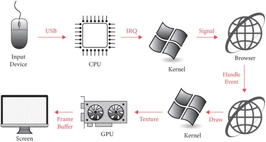
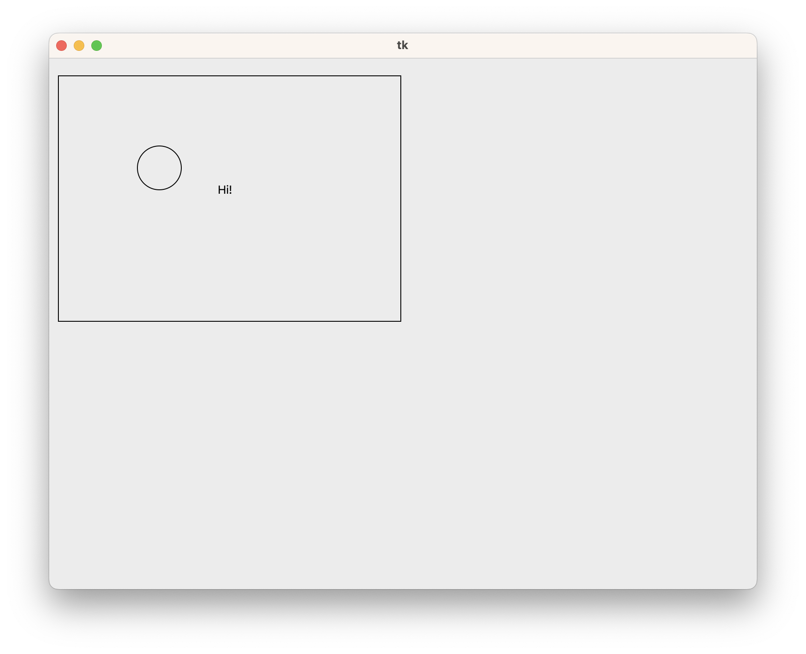
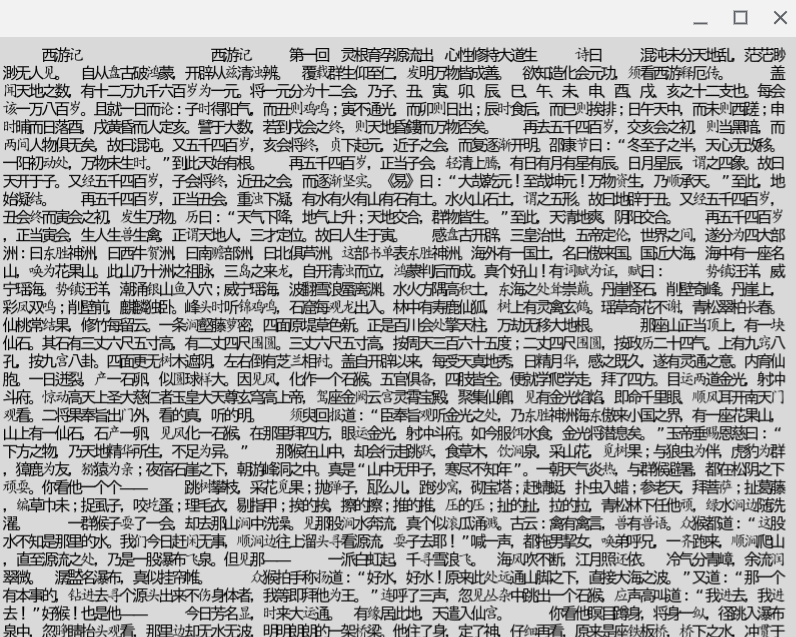
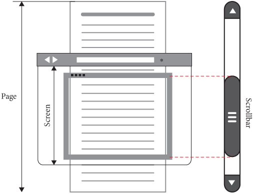

# 画面への描画（Drawing to the Screen）

> 出典: https://browser.engineering/graphics.html
> 取得日: 2026-11-14
> 原文: *Web Browser Engineering*（Pavel Panchekha、Chris Harrelson 著）第2章の日本語訳（学習用）

Webブラウザは、Webページをダウンロードするだけではありません。そのページをユーザーに見せる必要もあります。21世紀においては、それはグラフィカルなアプリケーションであることを意味します。[^1]そこでこの章では、私たちのブラウザにグラフィカルユーザーインターフェース（GUI）を備えさせます。

## ウィンドウの作成（Creating Windows）

デスクトップやノートパソコンでは、*デスクトップ環境*（desktop environment）、つまりウィンドウ、ボタン、マウスを提供するオペレーティングシステムが動いています。そのため、責任は分担されます。プログラムは自分のウィンドウを制御し、デスクトップ環境は画面を制御します。したがって、次のようになります。

- プログラムが新しいウィンドウを要求し、デスクトップ環境が実際にそれを表示する。

- プログラムが自分のウィンドウに描画し、デスクトップ環境がそれを画面に映す。

- デスクトップ環境が、クリックやキー入力をプログラムに知らせ、プログラムがそれに応答してウィンドウを再描画する。

これらすべてを手作業で行うのは少々面倒なので、プログラムは通常、これらの手順を簡単にする*グラフィカルツールキット*（graphical toolkit）を使います。Pythonには、`tkinter` というPythonパッケージに含まれるTkというグラフィカルツールキットが付属しています。[^2]使い方はごく簡単です。

```python
import tkinter
window = tkinter.Tk()
tkinter.mainloop()
```

> 通常、TkはPythonに同梱されているので、おそらくすでにインストールされています。ただし、一部のLinuxディストリビューションでは、`python3-tk` のような名前の別パッケージをインストールする必要があるかもしれません。

ここで `tkinter.Tk()` は、デスクトップ環境にウィンドウの作成を依頼し、そのウィンドウに描画するのに使えるオブジェクトを返します。`tkinter.mainloop()` の呼び出しは、次のようなループに入ります。[^3]

```python
while True:
    for evt in pendingEvents():
        handleEvent(evt)
    drawScreen()
```



*図1: イベント処理サイクルのフローチャート。*

> 図の補足: 画像内の英語テキストは訳していません。イベントを受け取って処理し、画面を描画してまたイベントを待つ、という循環を表しています。

ここで `pendingEvents` はまず、デスクトップ環境に最近のマウスクリックやキー入力を尋ね、次に `handleEvent` がアプリケーションを呼び出して状態を更新し、そして `drawScreen` がウィンドウを再描画します。この*イベントループ*（event loop）のパターン（図1参照）は、Webブラウザからビデオゲームまで多くのアプリケーションで一般的です。複雑なグラフィカルアプリケーションにおいて、すべてのイベントがいずれ処理され、画面がいずれ更新されることを保証するからです。

> **さらに詳しく（Going Further）**
>
> 皆さんはおそらくデスクトップコンピューターでブラウザを書いているでしょうが、多くの人はスマートフォンやタブレットなどのモバイルデバイスでWebにアクセスしています。モバイルデバイスにも、画面、描画ループ、この本で説明するほかのほとんどの要素があります。[^4]
>
> ただし、注目すべき違いがいくつかあります。アプリケーションは通常フルスクリーンで、一度に画面に描画するアプリケーションはひとつだけです。マウスはなく、仮想キーボードだけなので、おもな操作はタッチです。「デスクトップ専用」サイトと「モバイル対応」サイト、そしてピンチズームに対応するための、デスクトップにはない「ビジュアルビューポート」（visual viewport）という概念があります。[^5]また、画面のピクセル密度ははるかに高い一方、総画面解像度は通常は低くなります。これらすべての違いをサポートすることは可能ですが、かなりの作業です。この本では、演習として扱う場合を除いて、それらの実装には踏み込みません。
>
> また、デバイスはバッテリーで動くため、電力効率がはるかに重要です。同時に、中央演算処理装置（CPU）とメモリは大幅に低速で能力も低くなります。そのため、グラフィック処理装置（GPU）を活用することがはるかに重要になります。遅いCPUでは、良い性能を出すのがより難しいからです。モバイルブラウザは難題です！

## ウィンドウへの描画（Drawing to the Window）

私たちのブラウザは、Webページのテキストを*キャンバス*（canvas）に描画します。キャンバスとは、円、線、テキストを描ける、長方形のTkウィジェットです。たとえば、Tkでは次のようにキャンバスを作れます。[^6]

```python
window = tkinter.Tk()
canvas = tkinter.Canvas(window, width=800, height=600)
canvas.pack()
```

最初の行でウィンドウを作り、2行目でそのウィンドウの中に `Canvas` を作ります。Tkがキャンバスをどこに表示すればよいかわかるように、ウィンドウを引数として渡します。ほかの引数はキャンバスのサイズを定めます。私は800 × 600を選びました。昔のモニターによくあったサイズだからです。[^7]3行目はTk特有の癖で、キャンバスをウィンドウの中に配置します。Tkにはボタンやダイアログボックスなどのウィジェットもありますが、私たちのブラウザはそれらを使いません。見た目をより細かく制御する必要があり、それはキャンバスが提供してくれるからです。[^8]

すべてを整理しておくために、このコードをクラスに入れましょう。

```python
WIDTH, HEIGHT = 800, 600

class Browser:
    def __init__(self):
        self.window = tkinter.Tk()
        self.canvas = tkinter.Canvas(
            self.window,
            width=WIDTH,
            height=HEIGHT
        )
        self.canvas.pack()
```

キャンバスを作ったら、そのキャンバスに図形を描くメソッドを呼び出せます。新しい `Browser` クラスに移す `load` の中でやってみましょう。

```python
class Browser:
    def load(self, url):
        # ...
        self.canvas.create_rectangle(10, 20, 400, 300)
        self.canvas.create_oval(100, 100, 150, 150)
        self.canvas.create_text(200, 150, text="Hi!")
```

このコードを実行するには、`Browser` を作り、`load` を呼び、そしてTkの `mainloop` を開始します。

```python
if __name__ == "__main__":
    import sys
    Browser().load(URL(sys.argv[1]))
    tkinter.mainloop()
```

次のものが見えるはずです。キャンバスの左上隅の近くから始まり、その中心で終わる長方形、その長方形の中の円、そして円の隣の「Hi!」というテキストです（図2のとおり）。



*図2: 長方形、円、テキストを描いた、期待される出力例。*

Tkの座標では、*x* は左から右への位置、*y* は上から下への位置を表します。つまり、画面の下のほうが*大きい* *y* の値になり、数学で見慣れたものとは逆です。上のコードの座標をいじって、それぞれの引数が何を指すのか確かめてみてください。[^9]

> **さらに詳しく（Going Further）**
>
> Tkのキャンバスウィジェットは、ここでの使い方よりもはるかに強力です。[チュートリアル](https://tkdocs.com/tutorial/canvas.html)にあるように、キャンバスに描いた個々のものを動かしたり、それぞれに対するクリックイベントを待ち受けたりできます。この本ではこれらの機能を使いません。それらを自分で実装する方法を教えたいからです。

## テキストのレイアウト（Laying Out Text）

このキャンバスに、簡単なWebページを描いてみましょう。ここまでの私たちのブラウザは、Webページのソースコードを1文字ずつたどり、（タグは除いて）テキストをコンソールウィンドウに出力します。今度は、その文字を代わりにキャンバスに描きたいのです。

まず、前の章の `show` 関数を、HTML文書のテキスト内容を出力せずに*返すだけ*の関数に変えましょう。私はこれを `lex` と呼びます。[^10]

```python
def lex(body):
    text = ""
    # ...
    for c in body:
        # ...
        elif not in_tag:
            text += c
    return text
```

そして `load` が、そのテキストを1文字ずつ描画します。

```python
def load(self, url):
    # ...
    for c in text:
        self.canvas.create_text(100, 100, text=c)
```

このコードを実際のWebページで試しましょう。不可解に思える理由で、[^11]猿を描いた中国の古典小説『[西游记、すなわち*西遊記*（Journey to the West）の第1章](https://browser.engineering/examples/xiyouji.html)』で試すことにします。このURL[^12]を `request`、`lex`、`load` に通してください。ウィンドウの左上隅から少し内側に、黒いピクセルの大きな塊が見えるはずです。

文字ではなく塊になるのはなぜでしょうか。もちろん、すべての文字を同じ場所に描いているので、すべて重なってしまうからです。直しましょう。

```python
HSTEP, VSTEP = 13, 18
cursor_x, cursor_y = HSTEP, VSTEP
for c in text:
    self.canvas.create_text(cursor_x, cursor_y, text=c)
    cursor_x += HSTEP
```

変数 `cursor_x` と `cursor_y` は、ワープロにテキストを打ち込んでいるときのように、次の文字が置かれる場所を指します。13と18というマジックナンバーは、いくつかの値を試して、最も読みやすく見えるものを選びました。[^13]

これでテキストは左から右へ1行になります。しかし、キャンバスの幅が800ピクセル、1文字13ピクセルでは、1行におさまるのは約60文字です。小説を読むにはそれでは足りないので、画面の端に達したらテキストを*折り返す*（wrap）必要もあります。

```python
for c in text:
    # ...
    if cursor_x >= WIDTH - HSTEP:
        cursor_y += VSTEP
        cursor_x = HSTEP
```

このコードは、`cursor_x` が787ピクセルを超えたら、`cursor_y` を増やし、`cursor_x` をリセットします。[^14][^15]その手順を図3に示します。このようにテキストを折り返すことで、1行以上を読めるようになります。

ここに、その概念を示すウィジェットがあります（原書のWeb版では実際に操作できます）。

> [インタラクティブウィジェット: https://browser.engineering/widgets/lab2-render.html]

この時点で、[例のページ](https://browser.engineering/examples/xiyouji.html)をブラウザで読み込むと、図4のような見た目になるはずです。



*図4: 私たちのブラウザで描画した『西遊記』の第1章。*

これでたくさんのテキストを読めるようになりましたが、まだすべてではありません。テキストが十分に多いと、すべての行が画面におさまりません。ユーザーがページの別の部分を見るために、ページを*スクロール*できるようにしたいのです。

> **さらに詳しく（Going Further）**
>
> 英語のテキストでは、（少なくともハイフネーションなしでは）単語の途中で次の行に折り返すことはできませんが、中国語ではそれが既定の動作で、複数の文字からなる単語でも同じです。たとえば、「スイッチ」を意味する开关は、「オン」の开と「オフ」の关からできていますが、开の後ろで改行しても問題ありません。この既定の動作は、CSSの word-break プロパティで変更できます。`break-all` はどこでも改行を許し、`auto-phrase` は开关のような中国語や日本語の単語や句の内部でさえ改行を防ぎます。ここでの「auto」は、単語が作者によって指定されるのではなく、自動検出されることを指します。多くの場合、[単語頻度表](https://github.com/unicode-org/icu/blob/master/icu4c/source/data/brkitr/dictionaries/cjdict.txt)に基づいて、[動的計画法を使って](https://unicode-org.github.io/icu/userguide/boundaryanalysis/break-rules.html#details-about-dictionary-based-break-iteration)行われます。

## テキストのスクロール（Scrolling Text）

スクロールは、ページ座標（このテキストは*ページ*の上端から132ピクセルの位置にある）と、画面座標（60ピクセル下にスクロールしたので、このテキストは*画面*の上端から72ピクセルの位置にある）の間に、間接層を導入します（図5参照）。一般に、ブラウザはページ座標でページを*レイアウト*（lay out、ページ上のすべての配置場所を決める）し、そして画面座標でページを*ラスタライズ*（raster、すべてを描く）します。[^16]



*図5: ページ座標と画面座標の違い。*

> 図の補足: 画像内の英語テキストは訳していません。ページ全体の座標系と、スクロールで画面に見えている範囲の座標系とのずれを表しています。

私たちのブラウザにも、同じ分割を設けます。今のところ `load` は、各文字の位置の計算と描画、つまりレイアウトとレンダリングの両方を行っています。そうではなく、各文字の位置を計算して保存する `layout` 関数と、保存された位置に基づいて各文字を描画する別の `draw` 関数に分けましょう。こうすれば、`layout` はページ座標で動作でき、`draw` だけが画面座標を考えればよくなります。

まず `layout` から始めましょう。各文字に対して `canvas.create_text` を呼ぶ代わりに、文字をその位置とともにリストに追加します。`layout` は `Browser` の何にもアクセスする必要がないので、独立した関数にできます。

```python
def layout(text):
    display_list = []
    cursor_x, cursor_y = HSTEP, VSTEP
    for c in text:
        display_list.append((cursor_x, cursor_y, c))
        # ...
    return display_list
```

こうして得られた、表示すべきものの一覧を*ディスプレイリスト*（display list）と呼びます。[^17]`layout` はすべてページ座標に関するものなので、スクロールをサポートするためにそれ以外を変える必要はありません。

ディスプレイリストが計算できたら、`draw` はそれをループして各文字を描画する必要があります。`draw` はキャンバスにアクセスする必要があるので、`Browser` のメソッドにします。

```python
class Browser:
    def draw(self):
        for x, y, c in self.display_list:
            self.canvas.create_text(x, y, text=c)
```

これで `load` は、`layout` を呼んで、続けて `draw` を呼ぶだけで済みます。

```python
class Browser:
    def load(self, url):
        body = url.request()
        text = lex(body)
        self.display_list = layout(text)
        self.draw()
```

それではスクロールを追加できます。どれだけスクロールしたかを持つフィールドを追加しましょう。

```python
class Browser:
    def __init__(self):
        # ...
        self.scroll = 0
```

すると、ページ座標の `y` は、画面座標では `y - self.scroll` になります。

```python
def draw(self):
    for x, y, c in self.display_list:
        self.canvas.create_text(x, y - self.scroll, text=c)
```

`scroll` の値を変えると、ページは上下にスクロールするようになります。しかし、*ユーザー*はどうやって `scroll` を変えるのでしょうか。

ほとんどのブラウザは、上下キーを押したとき、スクロールホイールを回したとき、スクロールバーをドラッグしたとき、画面にタッチジェスチャーを行ったときに、ページをスクロールします。簡単にするために、下キーだけを実装しましょう。

Tkでは、関数をキーに*バインド*（bind）できます。これは、そのキーが押されたときにその関数を呼び出すようにTkに指示するものです。たとえば、下矢印キーにバインドするには、次のように書きます。

```python
def __init__(self):
    # ...
    self.window.bind("<Down>", self.scrolldown)
```

ここで `self.scrolldown` は*イベントハンドラ*（event handler）で、下矢印キーが押されるたびにTkが呼び出す関数です。[^18]やるべきことは、`scroll` を増やしてキャンバスを再描画するだけです。

```python
SCROLL_STEP = 100

def scrolldown(self, e):
    self.scroll += SCROLL_STEP
    self.draw()
```

これを試すと、スクロールするたびにすべてのテキストが2回目に描画されることに気づくでしょう。新しいテキストを描く前に、古いテキストを消していないからです。`canvas.delete` を呼んで、古いテキストを消しましょう。

```python
def draw(self):
    self.canvas.delete("all")
    # ...
```

これでスクロールが動くはずです。

> **さらに詳しく（Going Further）**
>
> ディスプレイリストを保存しておくと、スクロールが速くなります。スクロールのたびに `layout` を行わなくて済むからです。現代のブラウザは、これを[さらに推し進め](https://hacks.mozilla.org/2017/10/the-whole-web-at-maximum-fps-how-webrender-gets-rid-of-jank/)、JavaScriptやユーザーの操作でWebページが変化しても、ディスプレイリストの多くを保持し続けます。
>
> 一般に、スクロールはWebページに対する最も一般的なユーザー操作です。そのため実際のブラウザは、それを速くするために*途方もない*時間を費やしてきました。そのための方法のいくつかは、本の後のほうで取り上げます。

## より高速なレンダリング（Faster Rendering）

アプリケーションは、操作が滑らかに感じられるように、ページの内容を素早く再描画しなければなりません。[^19]また、ユーザーがいらいらしないように、クリックやキー入力にも素早く応答しなければなりません。「滑らかに感じる」は、もう少し正確にできます。ブラウザのようなグラフィカルアプリケーションは、通常、画面のリフレッシュレート、つまり*フレームレート*（frame rate）に等しい速度、あるいは固定の60 Hzで再描画することを目指します。[^20]これは、ブラウザが遅れないようにするには、すべての処理を1/60秒、つまり16ミリ秒未満で終えなければならないことを意味します。このため、16ミリ秒はアプリケーションの*アニメーションフレーム予算*（animation frame budget）と呼ばれます。

しかし、私たちのブラウザのスクロールはかなり遅いです。[^21]なぜでしょうか。`create_text` の内部で、文字の形に関する情報を読み込むのに時間がかかることがわかっています。スクロールを速くするには、それが必要なときだけ行うようにする（同時に、画面上のピクセルが常に正しいことも保証する）必要があります。

実際のブラウザには、このためのかなり巧妙な最適化がたくさんありますが、私たちのブラウザでは、単純な改善にとどめましょう。画面外の文字の描画を飛ばします。

```python
for x, y, c in self.display_list:
    if y > self.scroll + HEIGHT: continue
    if y + VSTEP < self.scroll: continue
    # ...
```

最初の `if` 文は表示ウィンドウの下にある文字を飛ばし、2つ目の `if` 文は上にある文字を飛ばします。2つ目の `if` 文で `y + VSTEP` は文字の下端です。表示ウィンドウに半分だけ入っている文字も描画しなければならないからです。

これでスクロールは気持ちよく速くなり、うまくいけば16ミリ秒のアニメーションフレーム予算に近づいているはずです。[^22]また、`layout` と `draw` を分けておいたので、この最適化を実装するために `layout` を変える必要はまったくありません。

> **さらに詳しく（Going Further）**
>
> Webページの操作がすべてアニメーションとは限らないことにも留意すべきです。マウスクリックのような離散的な操作もあります。離散的な操作には、[100ミリ秒]で応答すれば通常は十分であることが、研究で示されています。その閾値より短ければ、ほとんどの人は離散的な操作の速度に敏感ではありません。これは、スクロールのような操作とは大きく異なります。スクロールでは、およそ60 Hz未満の速度ははっきりと気づかれます。この2つの違いは、人間の心が動き（アニメーション）と離散的な操作を処理する方法、そして脳がそのような操作を決め、実行し、その結果を理解するのにかかる時間に関係しています。

## まとめ（Summary）

この章では、初歩的なコマンドラインのブラウザから、スクロールできるテキストを備えたグラフィカルユーザーインターフェースへと進みました。ブラウザは今や、次のことを行います。

- オペレーティングシステムと通信してウィンドウを作る。

- テキストをレイアウトして、そのウィンドウに描画する。

- キーボードのコマンドを待ち受ける。

- それに応じてウィンドウをスクロールする。

そして、こちらが、まさにこのWebページを描画している私たちのブラウザです（完全にインタラクティブです。クリックしてフォーカスを当てた後、下矢印キーでスクロールできるはずです）。[^23]

> [インタラクティブウィジェット: https://browser.engineering/widgets/lab2-browser.html]

次に、このブラウザを英語のテキストで動くようにし、可変幅の文字、行のレイアウト、書式設定といった複雑さを扱います。

## アウトライン（Outline）

私たちのブラウザの関数、クラス、メソッドの全体は、次のようになっているはずです。

```python
class URL:
    def __init__(url)

    def request()


def lex(body)

WIDTH, HEIGHT

HSTEP, VSTEP

def layout(text)

SCROLL_STEP

class Browser:
    def __init__()

    def draw()

    def load(url)

    def scrolldown(e)
```

## 演習（Exercises）

2-1 *改行*。`layout` を変更して、改行文字を見たら現在の行を終えて新しい行を始めるようにしてください。段落区切りのような印象を与えるために、*y* を `VSTEP` より大きく増やしてください。『西遊記』には詩が埋め込まれています。これで、それらを読み取れるようになります。

2-2 *マウスホイール*。上矢印を押したときに上にスクロールするサポートを追加してください。ページの先頭より上にスクロールできないようにしてください。次に、マウスホイールでスクロールしたときに発生する `<MouseWheel>` イベントをバインドしてください。[^24]関連するイベントオブジェクトには、どれだけ、どちらの方向にスクロールするかを示す `event.delta` の値があります。残念ながら、macOSとWindowsでは `event.delta` の符号が逆で、スケールも違います。Linuxでは、代わりに `<Button-4>` と `<Button-5>` イベントを使ってスクロールします。[^25]

2-3 *サイズ変更*。ブラウザのサイズを変更できるようにしてください。そのためには、`canvas.pack` に[`fill` と `expand` の引数を渡し](https://web.archive.org/web/20201111222645id_/http://effbot.org/tkinterbook/pack.htm)、ウィンドウのサイズが変わったときに発生する `<Configure>` イベントを呼び出してバインドします。ウィンドウの新しい幅と高さは、イベントオブジェクトの `width` と `height` フィールドにあります。ウィンドウのサイズが変わると、改行位置も変わらなければならないので、`layout` をもう一度呼ぶ必要があることを忘れないでください。

2-4 *スクロールバー*。ブラウザが、最後のディスプレイリストのエントリより下にスクロールしないようにしてください。[^26]画面の右端に、青い長方形のスクロールバーを描いてください。スクロールバーの大きさと位置が、図5のように、ブラウザが文書全体のどの部分を見ているかを反映するようにしてください。文書全体が画面におさまるときは、スクロールバーを隠してください。

2-5 *絵文字*。ブラウザに絵文字のサポートを追加してください 😀。絵文字は文字なので `create_text` で描画できますが、結果はあまり良くありません。代わりに、[OpenMojiプロジェクト](https://openmoji.org)にアクセスし、[「grinning face」](https://openmoji.org/library/#emoji=1F600)の絵文字をPNGファイルとしてダウンロードし、16 × 16ピクセルにリサイズして、ブラウザと同じフォルダに保存してください。TkのPhotoImageクラスで画像を読み込み、`create_image` メソッドでキャンバスに描画します。実際には、OpenMojiライブラリ全体をダウンロードしてください（右上の「Get OpenMojis」ボタンを探してください）。そうすれば、ブラウザはページで使われているどんな絵文字でも検索できます。

2-6 *`about:blank`*。現在は、不正な形式のURLがあるとブラウザがクラッシュします。そのためのエラー回復があるとずっと良く、代わりに空白のページを表示して、ユーザーがエラーを修正できるようにします。そのために、空白のページを描画するだけの特別な `about:blank` URLのサポートを追加し、不正な形式のURLを自動的に `about:blank` であるかのように描画させてください。

2-7 *別の文字方向*。すべての言語が左から右に読み、レイアウトされるわけではありません。アラビア語、ペルシア語、ヘブライ語は、右から左へ書く言語のよい例です。ブラウザへのコマンドラインフラグで、これの基本的なサポートを実装してください。[^27]英語の文は引き続き左から右にレイアウトされるべきですが、画面の右側から伸びていくようにします（意味を知るには、[この例](https://browser.engineering/examples/example2-rtl.html)をお好みのブラウザで読み込んでください）。[^28]

[^1]: 一部に、あまり知られていないテキストベースのブラウザがあります。私は2011年のほとんどを通じて、`w3m` をメインのブラウザとして使っていました。今は使っていません。
[^2]: このライブラリはTkと呼ばれ、もともとはTclという別の言語向けに書かれました。Pythonにはそれへのインターフェースが含まれているので、この名前になっています。
[^3]: この疑似コードは、コンピューターをロックアップさせる無限ループに見えるかもしれませんが、そうではありません。オペレーティングシステムがスレッドやプロセスの間でマルチタスクを行うか、`pendingEvents` の呼び出しがイベントが利用可能になるまでスリープするか、あるいはその両方です。いずれにせよ、ほかのコードが動き、ループが応答するためのイベントを生み出します。
[^4]: たとえば、実際のブラウザの多くには、デスクトップ版とモバイル版の両方があり、レンダリングエンジンのコードは両者でほぼ同じです。
[^5]: [この章のWebページ](https://browser.engineering/graphics.html)のソースを見てください。`<head>` に「viewport」の `<meta>` タグがあります。このタグは、そのページがモバイルデバイスをサポートしていることをブラウザに伝えます。これがないと、ブラウザはそのサイトを「デスクトップ専用」だと見なし、異なる方法で描画します。たとえば、ユーザーがピンチズームやダブルタップのジェスチャーで、ページの一部に焦点を合わせられるようにします。拡大されると、画面に見えているページの部分が「ビジュアルビューポート」で、文書全体の範囲が「レイアウトビューポート」です。これは、デスクトップには通常ない、ズームとスクロールの中間のようなものです。
[^6]: HTMLの `<canvas>` 要素に馴染みがあるかもしれません。これも似た発想で、図形を描ける2次元の長方形です。
[^7]: このサイズはSuper Video Graphics Array（SVGA）と呼ばれ、1987年に標準化されました。当時はおそらく本当にスーパーに思えたことでしょう。
[^8]: これが、デスクトップアプリケーションがWebページより統一されている理由です。デスクトップアプリケーションは一般に、共通のグラフィカルツールキットが提供するウィジェットを使うので、見た目が似てきます。
[^9]: 答えは[オンラインのドキュメント](https://anzeljg.github.io/rin2/book2/2405/docs/tkinter/canvas.html)にあります。
[^10]: 今後の展開の伏線です…。
[^11]: 基本的なタイポグラフィの議論を、次の章まで先送りするためです。
[^12]: リンクを右クリックして「URLをコピー」を選んでください。
[^13]: [第3章](https://browser.engineering/text.html)では、マジックナンバーをフォントメトリクスに置き換えます。
[^14]: タイプライターの昔は、*y* を増やすことは新しい*行*（line）を*送る*（feed）ことを意味し、*x* をリセットすることは、文字を打つ*キャリッジ*（carriage）を紙の左端へ*戻す*（return）ことを意味しました。そこでAmerican Standard Code for Information Interchange（[ASCII](https://en.wikipedia.org/wiki/ASCII)）は、ASCIIをテレタイプライターで直接実行できるように、これらの操作のために2つの別々の文字、「キャリッジリターン」と「ラインフィード」を標準化しました。現代のコンピューターには機械的なキャリッジがないのに、HTTPのヘッダが `\r\n` で区切られているのは、そのためです。
[^15]: 800ではないのは、13ピクセルから始めており、両側に均等な余白を残したいからです。
[^16]: ある意味では、です。実際に起こるのは、ページがまずビットマップやGPUテクスチャに描画され、そのビットマップ／テクスチャがスクロールに応じてずらされ、その結果が画面に描画される、というものです。[第11章](https://browser.engineering/visual-effects.html)でこの話題をさらに扱います。
[^17]: 「ディスプレイリスト」という用語は標準的なものです。
[^18]: `scrolldown` にはTkからイベントオブジェクトが引数として渡されますが、下にスクロールするのに、キー入力が起きたという事実以外の情報は必要ないので、`scrolldown` はそのイベントオブジェクトを無視します。
[^19]: 古いシステムでは、アプリケーションは画面に直接描画し、更新しなければ、最後にあったものがそのまま残りました。エラー状態で、あるウィンドウが別のウィンドウに「軌跡」を残すことがよくあったのはそのためです。現代のシステムは[コンポジティング](https://en.wikipedia.org/wiki/Compositing_window_manager)を使い、軌跡を避け、性能と分離も向上させます。それでも、表示内容を変えるために、アプリケーションはウィンドウの内容を再描画します。[第13章](https://browser.engineering/animations.html)でコンポジティングをさらに詳しく論じます。
[^20]: 今日のほとんどの画面のリフレッシュレートは60 Hzで、それが滑らかに見えるのに十分な速さだと一般に考えられています。しかし、120 Hzのような、より高いリフレッシュレートの新しいハードウェアも増えています。ブラウザがそこまで速くできるかどうかは、まだはっきりしません。一部のレンダリングエンジン、特にゲームは、レンダリング速度が追いつかないとわかっている場合、意図的に低いレートでリフレッシュします。
[^21]: 正確にどれくらい速いかは、オペレーティングシステムと既定のフォントに大きく左右されるようです。
[^22]: 私のコンピューターでは、それでもその予算の約2倍だったので、やるべきことがあります。それは今後の章で取り上げます。
[^23]: これは、ブラウザのソースコード全体をJavaScriptにクロスコンパイルし、iframeの中で動かしているものです。「restart」をクリックして描画する新しいWebページを選び、「start」をクリックしてください。以降の章でも、章末にこのようなものを置くので、それがどう改善されるかを確認できます。
[^24]: マウスがない場合は、タッチパッドのジェスチャーでも発生します。
[^25]: これについては、[Tkのマニュアル](https://wiki.tcl-lang.org/page/mousewheel)に詳しい情報があります。クロスプラットフォームのアプリケーションは、クロスブラウザのものよりずっと書くのが大変です！
[^26]: これは実際のブラウザでは完全には正しくありません。ブラウザは、画面の下の余分な空白や、意図的に画面外に描画されたオブジェクトの可能性を考慮する必要があります。[第5章](https://browser.engineering/layout.html)で、これを正しく実装します。
[^27]: [第4章](https://browser.engineering/html.html)に進めば、代わりに `<body>` 要素の[`dir`](https://developer.mozilla.org/en-US/docs/Web/HTML/Global_attributes/dir)属性を使えます。
[^28]: 実際の右から左へ書く言語の文は、その逆になるべきです。さらに、中国語や日本語など一部の東アジアの言語には、縦書きモードもあります。
